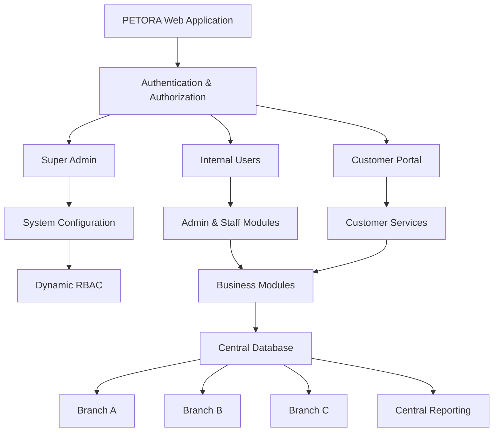

### PETORA – Complete System Specification

Nama sistem: PETORA Jenis sistem: Integrated Petshop & Pet Care Management System Arsitektur bisnis: Single Business – Multi Branch Platform: Responsive Web Application Bahasa utama: Indonesia Zona waktu default: Asia/Jakarta (WIB) Model akses: Dynamic RBAC + Permission Matrix + Branch-Level Access

Dokumen ini merupakan spesifikasi dasar pengembangan PETORA yang dapat langsung disalin sebagai dokumen kebutuhan sistem (Software Requirements Specification / SRS), diberikan kepada developer, atau digunakan sebagai instruksi proyek pengembangan dengan AI coding assistant.

### 1\. Visi dan tujuan sistem

PETORA adalah aplikasi web terintegrasi untuk mengelola seluruh operasional bisnis petshop dan pet care dalam satu sistem terpusat.

Sistem harus mampu mengelola:

* Penjualan produk petshop.

* Data pelanggan dan hewan peliharaan.

* Kasir dan transaksi.

* Persediaan dan gudang.

* Pembelian dan supplier.

* Grooming.

* Pet hotel dan daycare.

* Layanan transportasi hewan.

* Home grooming.

* Klinik dan rekam medis hewan.

* Keuangan dan laporan.

* Karyawan dan komisi.

* Membership dan loyalty.

* Multi-cabang.

* Pengaturan role dan hak akses secara dinamis.

### Prinsip arsitektur

* Satu perusahaan atau satu entitas bisnis.

* Memiliki banyak cabang.

* Seluruh cabang menggunakan satu sistem dan database terpusat.

* Data operasional mempunyai identitas cabang.

* Super Admin memiliki kendali sistem secara menyeluruh.

* Admin memiliki akses berdasarkan kewenangan yang diberikan.

* Dokter dan Customer memiliki ruang akses khusus.

* Role tambahan dapat dibuat oleh Super Admin melalui frontend.

* Integrasi pihak ketiga tidak boleh menjadi ketergantungan wajib pada codebase.

* Seluruh konfigurasi yang memungkinkan harus dilakukan melalui halaman pengaturan Super Admin.

* Sistem berbentuk web app responsif, bukan aplikasi native.

* Seluruh modul menggunakan desain, autentikasi, dan database yang terintegrasi.

### 2\. Arsitektur sistem



### Struktur organisasi

\- PETORA System

* Super Admin

* Business Owner

* Head Office

* Branch A

* Branch B

* Branch C

* Customer

Tidak menggunakan multi-tenant. Tidak ada pemisahan database berdasarkan perusahaan pelanggan. Semua cabang berada dalam satu organisasi bisnis.

Penting: Jika suatu hari PETORA digunakan oleh perusahaan lain yang tidak berada dalam satu organisasi, kebutuhan arsitekturnya harus dievaluasi ulang. Sistem saat ini hanya dirancang untuk satu entitas bisnis dengan banyak cabang.

### 3\. Role dan user management

PETORA harus mempunyai empat role sistem bawaan yang wajib tersedia.

| Role        | Tipe                  | Keterangan                   |
| ----------- | --------------------- | ---------------------------- |
| Super Admin | Protected System Role | Pengelola seluruh sistem     |
| Admin       | Protected System Role | Administrasi dan operasional |
| Dokter      | Protected System Role | Layanan medis                |
| Customer    | Protected System Role | Pemilik hewan                |

Role bawaan tidak dapat dihapus dan identitas dasarnya tidak boleh diganti. Super Admin dapat mengatur izin role bawaan sesuai batas kebijakan keamanan.

### 3.1 Custom Role

Super Admin dapat membuat role tambahan tanpa perubahan kode.

Contoh:

* Owner

* General Manager

* Branch Manager

* Supervisor

* Cashier

* Groomer

* Pet Hotel Staff

* Inventory Staff

* Warehouse Staff

* Purchasing Staff

* Accountant

* Customer Service

* Driver

* Veterinary Assistant

* Marketing

* Auditor

### 3.2 Fitur Role Management

| Fitur             | Spesifikasi                 |
| ----------------- | --------------------------- |
| Create Role       | Membuat role                |
| Edit Role         | Mengubah nama dan deskripsi |
| Delete Role       | Menghapus role custom       |
| Duplicate Role    | Menyalin role               |
| Assign Permission | Menentukan hak akses        |
| Assign User       | Memberikan role ke pengguna |
| Branch Assignment | Membatasi akses cabang      |
| Status            | Aktif/nonaktif              |
| Audit Log         | Mencatat perubahan          |
| Search            | Mencari role                |
| Filter            | Memfilter role              |
| Role Detail       | Melihat detail role         |

### 3.3 Permission Matrix

Setiap role memiliki izin per modul dan tindakan.

| Permission | Deskripsi             |
| ---------- | --------------------- |
| View       | Melihat               |
| Create     | Membuat               |
| Update     | Mengubah              |
| Delete     | Menghapus             |
| Approve    | Menyetujui            |
| Reject     | Menolak               |
| Export     | Mengekspor            |
| Print      | Mencetak              |
| Import     | Mengimpor             |
| Refund     | Refund                |
| Manage     | Mengelola konfigurasi |

Sistem juga harus memiliki data scope:

* All Branches: semua cabang.

* Assigned Branches: cabang yang ditugaskan.

* Own Data: data milik sendiri.

* Assigned Records: data yang ditugaskan kepada pengguna.

* Department Scope: data berdasarkan departemen.

### 3.4 Aturan khusus role

Super Admin

* Akses seluruh cabang.

* Akses seluruh modul.

* Mengatur role dan permission.

* Mengatur konfigurasi sistem.

* Mengelola integrasi eksternal.

* Tidak dapat dihapus melalui akun Admin.

* Tidak boleh menonaktifkan seluruh akun Super Admin tanpa prosedur pemulihan.

Admin

* Mengelola modul sesuai izin.

* Dapat mengelola pengguna sesuai izin khusus.

* Tidak dapat mengambil alih Super Admin.

* Tidak boleh memberikan permission di luar batas delegasinya.

Dokter

* Mengakses data medis sesuai penugasan.

* Membuat rekam medis.

* Membuat diagnosis dan resep.

* Mengakses histori medis.

* Tidak otomatis mendapat akses ke keuangan dan administrasi sistem.

Customer

* Mengelola profil sendiri.

* Mengelola hewan sendiri.

* Booking layanan.

* Melihat transaksi sendiri.

* Melihat rekam medis yang diizinkan.

* Tidak dapat mengakses data pelanggan lain.

### 4\. Modul lengkap PETORA

Berikut adalah daftar domain utama yang wajib menjadi bagian dari sistem.

| No. | Modul                | Fungsi utama          |
| --- | -------------------- | --------------------- |
| 1   | Dashboard            | Ringkasan operasional |
| 2   | User Management      | Pengguna dan akun     |
| 3   | Role & Permission    | Hak akses             |
| 4   | Branch Management    | Pengelolaan cabang    |
| 5   | Customer Management  | Data pelanggan        |
| 6   | Pet Management       | Data hewan            |
| 7   | POS & Sales          | Kasir                 |
| 8   | Product Management   | Produk                |
| 9   | Inventory            | Persediaan            |
| 10  | Warehouse            | Gudang                |
| 11  | Purchasing           | Pembelian             |
| 12  | Supplier             | Pemasok               |
| 13  | Grooming             | Layanan grooming      |
| 14  | Pet Hotel            | Penitipan             |
| 15  | Daycare              | Penitipan harian      |
| 16  | Booking              | Reservasi             |
| 17  | Transport            | Antar jemput          |
| 18  | Home Grooming        | Grooming ke rumah     |
| 19  | Veterinary           | Klinik hewan          |
| 20  | Medical Records      | Rekam medis           |
| 21  | Pharmacy             | Obat hewan            |
| 22  | Membership           | Keanggotaan           |
| 23  | Loyalty              | Poin pelanggan        |
| 24  | Promotion            | Promosi               |
| 25  | Staff Management     | Karyawan              |
| 26  | Attendance           | Absensi               |
| 27  | Commission           | Komisi                |
| 28  | Finance              | Keuangan              |
| 29  | Accounting           | Akuntansi             |
| 30  | Reports & Analytics  | Laporan               |
| 31  | Consignment          | Konsinyasi            |
| 32  | Notification         | Notifikasi            |
| 33  | Customer Portal      | Portal pelanggan      |
| 34  | System Settings      | Konfigurasi           |
| 35  | Integration Settings | Pengaturan integrasi  |

### 5\. Detail fungsi setiap modul

### 5.1 Dashboard

Dashboard harus menyesuaikan role dan cabang pengguna.

Fungsi:

* Ringkasan omzet harian, mingguan, bulanan.

* Total transaksi.

* Total pelanggan.

* Total hewan terdaftar.

* Booking hari ini.

* Grooming sedang berjalan.

* Pet hotel occupancy.

* Produk stok menipis.

* Produk mendekati kedaluwarsa.

* Pendapatan berdasarkan layanan.

* Performa setiap cabang.

* Grafik penjualan.

* Grafik pengeluaran.

* Top-selling products.

* Top services.

* Aktivitas terbaru.

Dashboard Super Admin menampilkan seluruh cabang. Dashboard pengguna cabang hanya menampilkan data cabang yang menjadi kewenangannya.

### 5.2 Branch Management

Fungsi:

* Tambah cabang.

* Edit informasi cabang.

* Aktif/nonaktif cabang.

* Kode cabang otomatis.

* Nama dan alamat.

* Nomor telepon.

* Email.

* Jam operasional.

* Pengaturan hari libur.

* Penentuan gudang utama.

* Penugasan karyawan.

* Penentuan layanan tersedia.

* Pengaturan harga per cabang jika diizinkan.

* Laporan performa cabang.

* Transfer stok antar cabang.

Setiap transaksi wajib memiliki `branch_id`.

### 5.3 Customer Management

Fungsi:

* Registrasi pelanggan.

* Nomor pelanggan otomatis.

* Nama lengkap.

* Nomor telepon.

* Email.

* Alamat.

* Tanggal lahir.

* Jenis kelamin jika diperlukan.

* Catatan pelanggan.

* Membership.

* Loyalty points.

* Histori pembelian.

* Histori booking.

* Histori pembayaran.

* Status pelanggan.

* Customer blacklist dengan alasan dan audit.

Nomor telepon dapat digunakan sebagai identitas pencarian pelanggan, tetapi bukan satu-satunya kunci database.

### 5.4 Pet Management

Setiap pelanggan dapat memiliki banyak hewan.

Data hewan:

* Pet ID.

* Nama hewan.

* Jenis hewan.

* Ras.

* Jenis kelamin.

* Tanggal lahir.

* Umur otomatis.

* Berat badan.

* Warna.

* Foto.

* Status steril.

* Alergi.

* Kondisi khusus.

* Riwayat vaksin.

* Riwayat pengobatan.

* Riwayat grooming.

* Riwayat hotel.

* Catatan perilaku.

* Catatan medis.

Sistem harus mendukung beberapa pemilik yang diizinkan untuk mengakses satu profil hewan, dengan pengaturan persetujuan pemilik utama.

### 5.5 POS & Sales

Fungsi:

* Transaksi produk.

* Transaksi layanan.

* Transaksi paket.

* Gabungan produk dan layanan dalam satu order.

* Pencarian barcode.

* Pencarian SKU.

* Keranjang belanja.

* Harga otomatis.

* Diskon nominal.

* Diskon persentase.

* Voucher.

* Membership pricing.

* Pajak dan biaya tambahan yang dapat dikonfigurasi.

* DP.

* Pembayaran sebagian.

* Pelunasan.

* Multiple payment methods.

* Cetak struk.

* Riwayat transaksi.

* Pembatalan transaksi dengan otorisasi.

* Refund dengan persetujuan.

* Retur produk.

* Shift kasir.

* Cash in.

* Cash out.

* Tutup kas.

* Selisih kas.

* Audit transaksi.

Satu order memiliki beberapa item, sedangkan pembayaran dapat dilakukan beberapa kali.

### 5.6 Product Management

Data produk:

* Nama produk.

* SKU.

* Barcode.

* Kategori.

* Brand.

* Deskripsi.

* Foto.

* Varian.

* Ukuran.

* Berat.

* Satuan.

* Harga modal.

* Harga jual.

* Harga grosir.

* Harga minimum.

* Supplier.

* Status produk.

* Status konsinyasi.

* Status kedaluwarsa jika relevan.

Fitur:

* Import produk.

* Export produk.

* Bulk update harga.

* Bulk update kategori.

* Duplikasi produk.

* Riwayat perubahan harga.

* Produk aktif/nonaktif.

### 5.7 Inventory & Warehouse

Fungsi:

* Stok per cabang.

* Multi-warehouse.

* Stok masuk.

* Stok keluar.

* Stock adjustment.

* Stock opname.

* Stock transfer.

* Transfer approval.

* Batch tracking.

* Expiry tracking.

* FIFO.

* FEFO.

* Minimum stock.

* Stock alert.

* Stock card.

* Stock movement history.

* Barang rusak.

* Barang hilang.

* Retur pelanggan.

* Retur supplier.

Setiap perubahan stok harus menghasilkan catatan `stock_movements`. Angka stok tidak boleh diubah langsung tanpa histori transaksi.

### 5.8 Purchasing & Supplier

Fungsi:

* Data supplier.

* Purchase request.

* Purchase order.

* Approval PO.

* Penerimaan barang.

* Penerimaan parsial.

* Pencocokan PO dengan penerimaan.

* Invoice supplier.

* Utang supplier.

* Pembayaran supplier.

* Retur pembelian.

* Histori pembelian.

* Analisis harga supplier.

### 5.9 Grooming Management

Fungsi:

* Master layanan grooming.

* Kategori layanan.

* Harga berdasarkan ukuran hewan.

* Harga berdasarkan jenis atau ras bila diperlukan.

* Durasi layanan.

* Add-on.

* Paket grooming.

* Booking.

* Kalender jadwal.

* Penugasan groomer.

* Check-in.

* Checklist grooming.

* Catatan kondisi awal.

* Dokumentasi sebelum dan sesudah.

* Status pengerjaan.

* Quality control.

* Check-out.

* Pembayaran.

* Komisi groomer.

* Riwayat grooming.

Status: `Pending → Confirmed → Checked In → In Progress → Quality Check → Completed → Paid`

### 5.10 Pet Hotel & Daycare

Fungsi:

* Data kamar.

* Jenis kamar.

* Kapasitas.

* Harga per malam.

* Harga per jam jika diperlukan.

* Booking.

* Kalender okupansi.

* Check-in.

* Check-out.

* Pindah kamar.

* Perpanjangan inap.

* Jadwal makan.

* Jadwal minum.

* Jadwal obat.

* Aktivitas harian.

* Dokumentasi.

* Catatan kesehatan.

* Biaya tambahan.

* Biaya keterlambatan.

* Pembayaran.

* Riwayat menginap.

Sistem tidak boleh menerima reservasi yang menyebabkan kapasitas kamar terlampaui.

### 5.11 Transport Management

Fungsi:

* Data kendaraan.

* Data driver.

* Booking transport.

* Alamat jemput.

* Alamat tujuan.

* Jadwal perjalanan.

* Penugasan driver.

* Tarif.

* Biaya tambahan.

* Status perjalanan.

* Bukti penjemputan.

* Bukti pengantaran.

* Histori perjalanan.

### 5.12 Home Grooming

Fungsi:

* Booking.

* Penentuan alamat.

* Penentuan jadwal.

* Penentuan groomer.

* Work order.

* Estimasi biaya perjalanan.

* Status kunjungan.

* Checklist grooming.

* Dokumentasi.

* Pembayaran.

* Komisi.

* Histori layanan.

### 5.13 Veterinary Management

Fungsi:

* Registrasi pasien.

* Registrasi pemilik.

* Jadwal konsultasi.

* Antrean klinik.

* Pemeriksaan.

* Anamnesis.

* Pemeriksaan fisik.

* Tanda vital.

* Diagnosis.

* SOAP.

* Treatment plan.

* Resep.

* Tindakan medis.

* Vaksinasi.

* Laboratorium.

* Rawat inap.

* Catatan anestesi.

* Persetujuan tindakan.

* Kontrol lanjutan.

* Tagihan klinik.

Rekam medis harus memiliki histori perubahan dan identitas dokter yang membuat atau mengubahnya.

### 5.14 Pharmacy & Medicine

Fungsi:

* Master obat.

* Kategori obat.

* Satuan.

* Batch.

* Kedaluwarsa.

* Stok obat.

* Resep.

* Pengeluaran obat.

* Retur obat.

* Peringatan kedaluwarsa.

* Histori pemberian obat.

* Harga modal.

* Harga jual.

* Penggunaan obat per pasien.

Akses obat dan resep dibatasi sesuai kewenangan dokter dan staf farmasi yang diberikan.

### 5.15 Membership & Loyalty

Fungsi:

* Master membership.

* Tingkatan member.

* Masa berlaku.

* Biaya keanggotaan.

* Poin transaksi.

* Penukaran poin.

* Reward.

* Stamp card.

* Riwayat poin.

* Saldo.

* Promo khusus member.

### 5.16 Promotion

Fungsi:

* Promo produk.

* Promo layanan.

* Diskon persentase.

* Diskon nominal.

* Buy 1 Get 1.

* Bundling.

* Voucher.

* Kode promo.

* Periode promo.

* Minimal transaksi.

* Maksimal diskon.

* Batas penggunaan.

* Target pelanggan.

* Target cabang.

* Status promo.

### 5.17 Staff Management

Fungsi:

* Data karyawan.

* Jabatan.

* Departemen.

* Cabang.

* Akun pengguna.

* Role.

* Hak akses.

* Status karyawan.

* Tanggal masuk.

* Dokumen karyawan.

* Jadwal kerja.

* Absensi.

* Cuti.

* Komisi.

* Histori aktivitas.

### 5.18 Commission

Fungsi:

* Komisi berdasarkan layanan.

* Komisi berdasarkan produk.

* Komisi persentase.

* Komisi nominal.

* Komisi per staf.

* Komisi per cabang.

* Komisi berdasarkan target.

* Perhitungan otomatis.

* Approval komisi.

* Laporan komisi.

* Histori pembayaran komisi.

### 5.19 Finance

Fungsi:

* Kas masuk.

* Kas keluar.

* Pendapatan.

* Pengeluaran.

* Piutang.

* Utang.

* Pembayaran supplier.

* Refund.

* Rekonsiliasi kas.

* Saldo kas per cabang.

* Laporan arus kas.

* Laporan laba rugi operasional.

### 5.20 Accounting

Jika modul akuntansi diaktifkan:

* Chart of Accounts.

* Jurnal umum.

* Jurnal penjualan.

* Jurnal pembelian.

* Jurnal pembayaran.

* Buku besar.

* Neraca saldo.

* Laporan laba rugi.

* Neraca.

* Arus kas.

* Periode akuntansi.

* Tutup buku.

* Audit jurnal.

Jurnal yang sudah diposting tidak boleh dihapus secara langsung. Koreksi harus melalui jurnal pembalik atau prosedur koreksi yang tercatat.

### 5.21 Consignment

Fungsi:

* Supplier konsinyasi.

* Kontrak.

* Produk titipan.

* Stok titipan.

* Penjualan.

* Komisi supplier.

* Perhitungan settlement.

* Pembayaran settlement.

* Retur.

* Histori konsinyasi.

### 5.22 Notification

Fungsi:

* Notifikasi dalam aplikasi.

* Booking baru.

* Booking dikonfirmasi.

* Jadwal grooming.

* Check-in hotel.

* Stok menipis.

* Produk kedaluwarsa.

* PO menunggu persetujuan.

* Pembayaran.

* Pengingat vaksin.

* Pengingat kontrol.

* Aktivitas penting.

Notifikasi internal harus tetap berfungsi meskipun integrasi email atau WhatsApp belum dikonfigurasi.

### 5.23 Customer Portal

Fungsi:

* Registrasi.

* Login.

* Lupa kata sandi.

* Profil pelanggan.

* Profil hewan.

* Booking grooming.

* Booking hotel.

* Booking daycare.

* Booking transport.

* Katalog produk.

* Keranjang belanja.

* Checkout.

* Histori order.

* Histori booking.

* Pembayaran.

* Riwayat vaksin.

* Riwayat medis yang diizinkan.

* Membership.

* Loyalty.

* Voucher.

* Review.

* Pengaduan.

### 5.24 System Settings

Fungsi:

* Nama bisnis.

* Logo.

* Alamat.

* Nomor telepon.

* Mata uang.

* Zona waktu.

* Format tanggal.

* Format nomor transaksi.

* Pengaturan pajak.

* Pengaturan struk.

* Pengaturan cabang.

* Pengaturan bahasa.

* Pengaturan notifikasi.

* Pengaturan keamanan.

* Backup.

* Audit log.

### 5.25 Integration Settings

Seluruh pengaturan integrasi pihak ketiga harus dikelola dari frontend Super Admin.

Contoh kategori:

* Payment gateway.

* WhatsApp.

* Email SMTP.

* Google Maps.

* Printer.

* Barcode scanner.

* Cloud storage.

* Accounting eksternal.

* Marketplace.

* API eksternal.

Prinsipnya:

* Super Admin dapat menambahkan konfigurasi.

* Super Admin dapat mengisi API key atau credential.

* Super Admin dapat mengaktifkan atau menonaktifkan integrasi.

* Super Admin dapat melakukan test connection.

* Super Admin dapat melihat status integrasi.

* Super Admin dapat mengatur konfigurasi per cabang jika didukung.

* Super Admin dapat mengatur template pesan.

* Super Admin dapat melihat histori request dan error yang aman ditampilkan.

Batas teknis penting: Pengaturan integrasi melalui frontend bukan berarti secret API dikirim atau disimpan di browser. Credential wajib disimpan secara aman di backend dan tidak boleh dikembalikan ke frontend. Agar tidak perlu mengubah codebase setiap kali menambahkan integrasi, PETORA harus menggunakan arsitektur connector/adapter yang dapat dikonfigurasi. Integrasi baru yang membutuhkan protokol atau kemampuan yang belum didukung tetap membutuhkan pengembangan adapter atau pemasangan komponen backend. Tidak boleh mengklaim semua integrasi eksternal bisa berjalan hanya dengan mengisi form.

### 6\. Sistem integrasi pihak ketiga

PETORA tidak boleh bergantung pada layanan pihak ketiga untuk menjalankan fungsi inti sistem.

Prinsip desain:

| Komponen          | Ketentuan             |
| ----------------- | --------------------- |
| POS               | Native PETORA         |
| Inventory         | Native PETORA         |
| Booking           | Native PETORA         |
| Grooming          | Native PETORA         |
| Pet Hotel         | Native PETORA         |
| CRM               | Native PETORA         |
| Finance           | Native PETORA         |
| User & Permission | Native PETORA         |
| Payment Gateway   | Konfigurasi eksternal |
| WhatsApp          | Konfigurasi eksternal |
| Email SMTP        | Konfigurasi eksternal |
| Google Maps       | Konfigurasi eksternal |

### Halaman Super Admin untuk integrasi

Setiap integrasi memiliki:

* Nama provider.

* Status integrasi.

* Form credential.

* Tombol test connection.

* Tombol enable/disable.

* Konfigurasi tambahan.

* Pengaturan cabang.

* Log integrasi.

* Informasi error.

* Dokumentasi konfigurasi.

Contoh struktur:

```text
Super Admin
  └── Settings
       └── Integrations
            ├── Payment Gateway
            ├── WhatsApp
            ├── Email SMTP
            ├── Google Maps
            ├── Cloud Storage
            └── Custom Connector
```

Tidak boleh ada API key, secret key, password SMTP, atau token rahasia di source frontend, local storage, maupun log yang bisa dibaca pengguna.

### 7\. Struktur database PETORA

Database harus menggunakan relasi yang konsisten dan mendukung transaksi multi-cabang.

### 7.1 Master tables

```text
business_settings
branches
branch_settings
users
roles
permissions
role_permissions
user_roles
user_branch_access
modules
departments
employees
```

### 7.2 Customer & Pet

```text
customers
customer_addresses
customer_contacts
pets
pet_owners
pet_photos
pet_notes
pet_allergies
pet_vaccinations
pet_medical_records
pet_weight_histories
```

### 7.3 Product & Inventory

```text
product_categories
product_brands
products
product_variants
product_prices
warehouses
warehouse_stocks
stock_batches
stock_movements
stock_adjustments
stock_opnames
stock_transfers
stock_transfer_items
```

### 7.4 Supplier & Purchasing

```text
suppliers
purchase_requests
purchase_orders
purchase_order_items
goods_receipts
goods_receipt_items
supplier_invoices
supplier_payments
purchase_returns
purchase_return_items
```

### 7.5 POS & Transaction

```text
orders
order_items
order_discounts
payments
payment_allocations
refunds
refund_items
cash_sessions
cash_movements
sales_returns
receipts
```

### 7.6 Grooming

```text
grooming_services
grooming_packages
grooming_bookings
grooming_sessions
grooming_assignments
grooming_checklists
grooming_photos
grooming_notes
grooming_addons
```

### 7.7 Hotel & Daycare

```text
hotel_rooms
hotel_room_types
hotel_pricing
hotel_bookings
hotel_stays
hotel_checkins
hotel_checkouts
hotel_care_schedules
hotel_activity_logs
hotel_additional_charges
daycare_bookings
```

### 7.8 Veterinary

```text
veterinary_appointments
medical_visits
medical_examinations
medical_diagnoses
medical_treatments
medical_prescriptions
medical_prescription_items
medical_procedures
medical_lab_tests
medical_vaccinations
medical_hospitalizations
medical_consents
```

### 7.9 HR & Finance

```text
attendance
work_schedules
employee_commissions
commission_rules
commission_transactions
expenses
cash_accounts
accounts_receivable
accounts_payable
chart_of_accounts
journal_entries
journal_entry_lines
accounting_periods
```

### 7.10 Membership & Promotion

```text
membership_plans
customer_memberships
loyalty_accounts
loyalty_transactions
rewards
vouchers
promotions
promotion_conditions
promotion_usages
```

### 7.11 System

```text
notifications
notification_templates
audit_logs
system_settings
integration_providers
integration_configurations
integration_logs
file_attachments
system_backups
```

### 7.12 Aturan database wajib

* Semua tabel menggunakan primary key yang konsisten.

* Gunakan foreign key untuk menjaga integritas relasi.

* Semua tabel transaksi mempunyai nomor transaksi unik.

* Transaksi operasional memiliki `branch_id`.

* Master data global dapat digunakan oleh seluruh cabang.

* Master data tertentu dapat memiliki konfigurasi per cabang.

* Gunakan soft delete untuk data yang memang perlu dipertahankan.

* Data transaksi keuangan tidak boleh dihapus permanen melalui operasi biasa.

* Gunakan database transaction untuk proses yang melibatkan beberapa tabel.

* Gunakan decimal untuk nilai uang.

* Simpan tanggal dan waktu dengan standar UTC, lalu tampilkan berdasarkan zona waktu pengguna atau konfigurasi bisnis.

* Simpan perubahan penting dalam audit log.

### 8\. Desain UI/UX dan navigasi

PETORA harus menjadi responsive web application yang dapat diakses melalui:

* Desktop.

* Laptop.

* Tablet.

* Smartphone Android.

* Smartphone iPhone.

Tidak perlu membuat aplikasi native terpisah.

### 8.1 Desktop layout

Struktur:

```text
┌────────────────────────────────────────────────────┐
│ PETORA       Search      Notification    Profile   │
├──────────────┬─────────────────────────────────────┤
│              │                                     │
│ Dashboard    │       MAIN CONTENT                   │
│ Customer     │                                     │
│ Pets         │       Dashboard / Tables / Forms    │
│ POS          │                                     │
│ Inventory    │                                     │
│ Grooming     │                                     │
│ Hotel        │                                     │
│ Veterinary   │                                     │
│ Finance      │                                     │
│ Reports      │                                     │
│ Settings     │                                     │
│              │                                     │
└──────────────┴─────────────────────────────────────┘
```

### 8.2 Mobile layout

* Sidebar berubah menjadi drawer.

* Navigasi utama mudah diakses.

* Form menggunakan layout satu kolom.

* Tabel berubah menjadi card/list responsif.

* Tombol utama mudah dijangkau.

* POS dioptimalkan untuk layar kecil.

* Kalender booking mendukung tampilan mobile.

* Modal tidak boleh keluar dari ukuran layar.

* Semua halaman mendukung scrolling vertikal.

* Tidak boleh ada horizontal overflow yang tidak diperlukan.

### 8.3 Design system

Gunakan identitas visual PETORA:

* Tampilan modern.

* Bersih dan profesional.

* Warna utama hijau tua atau teal.

* Background netral.

* Card dengan radius konsisten.

* Typography mudah dibaca.

* Ikon konsisten.

* Komponen reusable.

* Light mode sebagai default.

* Dark mode opsional.

Komponen wajib:

```text
Button
Input
Textarea
Select
Checkbox
Radio
Date Picker
Time Picker
Modal
Drawer
Dropdown
Tabs
Table
Data Grid
Pagination
Search
Filter
Badge
Alert
Toast
Tooltip
Card
Stat Card
Chart
Calendar
File Upload
Image Preview
Confirmation Dialog
```

### 9\. Arsitektur teknis

Teknologi dapat ditentukan oleh tim developer, tetapi arsitektur harus memenuhi persyaratan berikut.

| Layer              | Tanggung jawab                   |
| ------------------ | -------------------------------- |
| Frontend           | UI, navigasi, validasi awal      |
| Backend            | Business logic dan authorization |
| Database           | Penyimpanan data terpusat        |
| File Storage       | Foto hewan dan dokumen           |
| Authentication     | Login dan sesi pengguna          |
| RBAC Engine        | Role dan permission              |
| Integration Engine | Koneksi eksternal                |
| Reporting Engine   | Analisis dan laporan             |

### Persyaratan arsitektur

* Gunakan modular architecture.

* Setiap modul mempunyai batas tanggung jawab jelas.

* Frontend dan backend dipisahkan.

* Seluruh data diproses melalui API backend.

* Business logic tidak boleh hanya berada di frontend.

* Permission wajib diverifikasi di backend.

* Database menggunakan relasi yang konsisten.

* Gunakan reusable service dan component.

* Hindari duplikasi business logic.

* Sistem harus dapat dikembangkan tanpa merusak modul lain.

### Contoh struktur project

```text
PETORA/
│
├── frontend/
│   ├── components/
│   ├── layouts/
│   ├── pages/
│   ├── modules/
│   ├── hooks/
│   ├── services/
│   ├── permissions/
│   └── assets/
│
├── backend/
│   ├── modules/
│   │   ├── auth/
│   │   ├── users/
│   │   ├── roles/
│   │   ├── branches/
│   │   ├── customers/
│   │   ├── pets/
│   │   ├── products/
│   │   ├── inventory/
│   │   ├── purchasing/
│   │   ├── pos/
│   │   ├── grooming/
│   │   ├── hotel/
│   │   ├── veterinary/
│   │   ├── finance/
│   │   └── reports/
│   │
│   ├── middleware/
│   ├── services/
│   ├── integrations/
│   ├── policies/
│   └── utils/
│
├── database/
│   ├── migrations/
│   ├── seeders/
│   └── schemas/
│
├── storage/
│
└── documentation/
```

### 10\. Security requirements

PETORA wajib menerapkan:

| Keamanan          | Persyaratan                             |
| ----------------- | --------------------------------------- |
| Authentication    | Login aman                              |
| Password          | Hashing menggunakan algoritma yang kuat |
| Session           | Pengelolaan sesi aman                   |
| RBAC              | Hak akses backend                       |
| Branch Scope      | Isolasi data cabang                     |
| Audit Trail       | Histori aktivitas                       |
| Rate Limiting     | Mencegah penyalahgunaan                 |
| CSRF              | Proteksi request                        |
| XSS               | Sanitasi input dan output               |
| SQL Injection     | Query aman                              |
| File Upload       | Validasi jenis dan ukuran file          |
| Backup            | Backup database terjadwal               |
| Recovery          | Prosedur pemulihan                      |
| Encryption        | Enkripsi data sensitif                  |
| Secret Management | Penyimpanan credential yang aman        |

Khusus rekam medis:

* Dokter yang membuat rekam medis tercatat.

* Setiap revisi mempunyai histori.

* Data medis tidak dapat diubah oleh Customer.

* Customer hanya melihat data yang diberikan aksesnya.

* Data medis tidak boleh ikut terhapus ketika akun pelanggan dinonaktifkan.

### 11\. Business rules utama

* Satu pelanggan dapat memiliki banyak hewan.

* Satu hewan dapat memiliki banyak histori layanan.

* Satu transaksi dapat memiliki banyak produk dan layanan.

* Satu order dapat menerima beberapa pembayaran.

* Satu cabang dapat memiliki beberapa gudang.

* Stok harus dihitung berdasarkan gudang dan cabang.

* Transfer stok harus melalui proses pengiriman dan penerimaan.

* Setiap layanan harus memiliki status operasional.

* Booking tidak boleh berbenturan dengan kapasitas dan jadwal.

* Komisi dihitung berdasarkan aturan yang aktif saat transaksi.

* Refund harus memiliki otorisasi.

* Transaksi yang telah dibayar tidak boleh diedit sembarangan.

* Customer hanya mengakses datanya sendiri.

* Dokter memiliki batas akses sesuai penugasan dan kewenangan.

* Role custom tidak boleh melewati batas keamanan sistem.

* Perubahan harga dan stok harus tercatat.

* Transaksi antar cabang harus dapat dilacak.

* Pengaturan integrasi tidak boleh membocorkan credential.

* Data cabang harus dapat dikonsolidasikan pada laporan pusat.

* Perubahan konfigurasi penting harus masuk audit log.

### 12\. Non-functional requirements

| Area            | Persyaratan                                                         |
| --------------- | ------------------------------------------------------------------- |
| Responsive      | Seluruh ukuran layar                                                |
| Performance     | Halaman umum ditargetkan tampil dalam 2–3 detik pada kondisi normal |
| Scalability     | Mendukung pertumbuhan transaksi dan cabang                          |
| Availability    | Memiliki mekanisme monitoring                                       |
| Usability       | Navigasi sederhana                                                  |
| Maintainability | Modular dan terdokumentasi                                          |
| Security        | Backend authorization                                               |
| Compatibility   | Browser modern                                                      |
| Data Integrity  | Relasi dan transaksi konsisten                                      |
| Backup          | Backup otomatis dan teruji                                          |
| Accessibility   | Navigasi dan kontras yang baik                                      |
| Localization    | Bahasa Indonesia dan format rupiah                                  |

Target performa harus diuji dengan data dan beban pengguna yang realistis, bukan hanya berdasarkan tampilan demo.

### 13\. Acceptance criteria

PETORA belum dianggap selesai sebelum memenuhi pengujian berikut.

| No. | Pengujian                             | Hasil yang diharapkan     |
| --- | ------------------------------------- | ------------------------- |
| 1   | Login Super Admin                     | Berhasil                  |
| 2   | Membuat role custom                   | Berhasil                  |
| 3   | Mengatur permission                   | Berhasil                  |
| 4   | Menghapus role custom                 | Berhasil dengan validasi  |
| 5   | Menghapus role bawaan                 | Ditolak                   |
| 6   | Membuat cabang                        | Berhasil                  |
| 7   | Membatasi user per cabang             | Berhasil                  |
| 8   | Membuat pelanggan                     | Berhasil                  |
| 9   | Menambahkan hewan                     | Berhasil                  |
| 10  | Melakukan penjualan                   | Berhasil                  |
| 11  | Mengurangi stok otomatis              | Berhasil                  |
| 12  | Melakukan transfer stok               | Berhasil                  |
| 13  | Booking grooming                      | Berhasil                  |
| 14  | Booking pet hotel                     | Memeriksa kapasitas       |
| 15  | Membuat rekam medis                   | Berhasil                  |
| 16  | Membuat pembayaran bertahap           | Berhasil                  |
| 17  | Membuat laporan cabang                | Berhasil                  |
| 18  | Mengakses data cabang lain tanpa izin | Ditolak                   |
| 19  | Customer membuka data pelanggan lain  | Ditolak                   |
| 20  | Membuka PETORA dari smartphone        | Responsif                 |
| 21  | Integrasi belum dikonfigurasi         | Modul inti tetap berjalan |
| 22  | Audit perubahan permission            | Tercatat                  |

### 14\. Roadmap pengembangan

Saya menyarankan enam fase pengerjaan.

| Fase | Fokus              | Output                                    |
| ---- | ------------------ | ----------------------------------------- |
| 1    | Foundation         | Login, database, role, permission, cabang |
| 2    | Core Petshop       | Customer, Pet, Product, Inventory, POS    |
| 3    | Service Operations | Booking, Grooming, Hotel, Daycare         |
| 4    | Veterinary         | Klinik, rekam medis, farmasi              |
| 5    | Management         | Finance, HR, Loyalty, Reporting           |
| 6    | Advanced           | Integrasi, konsinyasi, analitik, optimasi |

Setiap fase harus melewati pengujian sebelum berlanjut ke fase berikutnya.

### 15\. Instruksi utama untuk developer / AI coding assistant

Bagian berikut dapat digunakan sebagai instruksi proyek utama.

# MASTER DEVELOPMENT INSTRUCTION — PETORA

Bangun sebuah responsive web application bernama **PETORA**, yaitu Integrated Petshop & Pet Care Management System.

## A. Business Architecture

PETORA menggunakan model Single Business – Multi Branch.

Ketentuan:
- Satu organisasi bisnis.
- Banyak cabang.
- Satu database terpusat.
- Semua cabang berbagi master data yang sesuai.
- Transaksi memiliki identitas cabang.
- Data dapat ditampilkan secara konsolidasi.
- Tidak menggunakan arsitektur multi-tenant.

## B. Mandatory System Roles

Sediakan empat role bawaan:
1. Super Admin
2. Admin
3. Dokter
4. Customer

Keempat role tidak dapat dihapus.

Super Admin dapat membuat role custom tanpa mengubah source code.

Implementasikan Dynamic RBAC, Permission Matrix, Branch Scope, dan Data Scope.

## C. Platform

- Responsive web application.
- Desktop, laptop, tablet, dan smartphone.
- Tidak perlu membuat aplikasi native Android/iOS.
- Customer Portal dapat diakses melalui browser.
- Gunakan satu sistem autentikasi dan database terintegrasi.

## D. Core Modules

Implementasikan:
1. Dashboard
2. Authentication
3. User Management
4. Role & Permission
5. Branch Management
6. Customer Management
7. Pet Management
8. POS & Sales
9. Product Management
10. Inventory
11. Warehouse
12. Purchasing
13. Supplier
14. Grooming
15. Pet Hotel
16. Daycare
17. Booking
18. Transport
19. Home Grooming
20. Veterinary
21. Medical Records
22. Pharmacy
23. Membership
24. Loyalty
25. Promotion
26. Staff Management
27. Attendance
28. Commission
29. Finance
30. Accounting
31. Reporting
32. Consignment
33. Notification
34. Customer Portal
35. System Settings
36. Integration Settings

Setiap modul harus memiliki halaman, form, tabel, validasi, business logic, hak akses, dan integrasi data yang sesuai.

## E. Custom Role Requirements

Super Admin harus dapat:
- Membuat role.
- Mengubah role.
- Menghapus role custom.
- Menggandakan role.
- Mengatur permission.
- Menentukan cabang.
- Menentukan data scope.
- Mengaktifkan dan menonaktifkan role.
- Melihat histori perubahan.

Permission minimum:
VIEW, CREATE, UPDATE, DELETE, APPROVE, REJECT, EXPORT, IMPORT, PRINT, REFUND, MANAGE.

Semua authorization harus diperiksa di backend.

Role bawaan harus memiliki perlindungan khusus dan tidak boleh dapat dihapus atau diambil alih oleh role lain.

## F. Third-Party Integration Architecture

Semua pengaturan integrasi harus tersedia melalui halaman frontend Super Admin.

Buat Integration Management yang mendukung:
- Provider configuration.
- API credentials.
- Enable/disable.
- Test connection.
- Branch configuration.
- Template configuration.
- Integration logs.
- Error monitoring.

Gunakan connector/adapter architecture.

Jangan menanamkan credential di frontend.

Jangan menjadikan layanan eksternal sebagai ketergantungan wajib untuk menjalankan fungsi inti PETORA.

Penambahan integrasi baru yang belum didukung memerlukan adapter backend yang sesuai, tetapi konfigurasi integrasi yang telah didukung harus dapat dilakukan tanpa mengubah source code.

## G. Database Requirements

Gunakan database relasional.

Implementasikan:
- Primary key.
- Foreign key.
- Index.
- Database migrations.
- Seeders.
- Transactions.
- Audit logs.
- Soft delete sesuai kebutuhan.
- Branch ID pada data transaksi.
- Stock movement history.
- Payment allocation.
- Medical history tracking.

Jangan menyimpan seluruh data dalam satu tabel besar.

## H. UI/UX Requirements

Buat desain modern, profesional, bersih, dan konsisten.

Gunakan:
- Sidebar desktop.
- Mobile drawer.
- Responsive tables.
- Reusable forms.
- Reusable modal.
- Search dan filter.
- Pagination.
- Dashboard cards.
- Charts.
- Calendar.
- Notification center.

Semua halaman harus memiliki loading, empty, success, dan error states.

Jangan membuat tombol dekoratif yang tidak mempunyai fungsi.

## I. Security Requirements

Implementasikan:
- Secure authentication.
- Password hashing.
- Session security.
- Server-side permission checking.
- Branch-level authorization.
- Customer data ownership.
- Medical data protection.
- Input validation.
- File validation.
- Rate limiting.
- Audit logs.
- Backup and recovery.
- Secure credential storage.

## J. Development Rules

1. Buat database schema terlebih dahulu.
2. Buat authentication dan authorization.
3. Buat sistem cabang.
4. Buat master data.
5. Kembangkan modul secara bertahap.
6. Hubungkan semua modul menggunakan relasi database yang benar.
7. Jangan menggunakan dummy data sebagai pengganti business logic.
8. Jangan membuat halaman yang tidak berfungsi.
9. Jangan menggandakan fungsi yang sudah tersedia.
10. Jangan mengubah struktur modul lain tanpa memeriksa dependensinya.
11. Setiap perubahan harus diuji.
12. Dokumentasikan API dan database.
13. Pastikan semua halaman responsif.
14. Pastikan seluruh hak akses berlaku di backend.
15. Gunakan satu sumber kebenaran untuk konfigurasi sistem.

## K. Definition of Done

PETORA dinyatakan siap digunakan apabila:
- Seluruh modul wajib berfungsi.
- Semua role dan permission berjalan.
- Multi-cabang berjalan dengan benar.
- Transaksi dan stok konsisten.
- Customer Portal berfungsi.
- Rekam medis aman.
- Laporan dapat direkonsiliasi.
- Integrasi dapat dikonfigurasi melalui Super Admin.
- Tidak ada credential rahasia di frontend.
- Seluruh tampilan responsif.
- Seluruh proses utama sudah melewati pengujian.

**Nama produk: PETORA**

**Product identity: Integrated Petshop & Pet Care Management System.**

### 16\. Rekomendasi implementasi akhir

Ada tiga keputusan desain yang sebaiknya dipertahankan sejak awal:

* Single business, multi-branch: jangan mencampur konsep multi-tenant dengan struktur cabang.

* Dynamic RBAC: Super Admin bisa membuat role dan mengatur hak akses melalui dashboard.

* Configurable integrations: konfigurasi pihak ketiga dilakukan dari frontend Super Admin, sementara proses rahasia dan komunikasi API tetap ditangani backend.

Dengan spesifikasi ini, PETORA mempunyai fondasi untuk berkembang dari petshop sederhana menjadi sistem manajemen pet care yang mencakup retail, grooming, hotel, daycare, dan klinik hewan.
