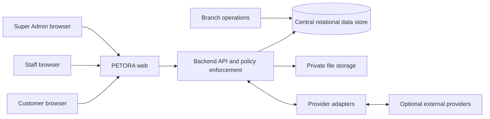

# 02 — Software Requirements Specification (SRS)

**Status:** Baseline kebutuhan untuk review; stack dan implementasi belum tersedia.  
**Terminologi status:** “shall” berarti wajib sebagai kebutuhan produk; detail bertanda TBD perlu keputusan.

## 1. Tujuan dan ruang lingkup

Menentukan perilaku yang harus dipenuhi sistem PETORA, aplikasi web responsif satu organisasi dengan banyak cabang, database terpusat dan akses berdasarkan role/permission/scope. SRS ini memformalkan spesifikasi sumber; ia bukan deskripsi produk yang telah beroperasi.

## 2. Konteks dan batas sistem

Cabang adalah unit operasional di organisasi yang sama, bukan tenant. Provider eksternal opsional (payment, email, WhatsApp, maps, accounting, storage) tidak boleh menjadi ketergantungan modul inti.

## 3. Aktor dan batas akses

Role sistem terlindungi: `SUPER_ADMIN`, `ADMIN`, `DOKTER`, `CUSTOMER`. Role custom dapat ditambah Super Admin. Role tidak otomatis memberikan scope: setiap keputusan menggabungkan permission tindakan, cabang, ownership/assignment, dan kebijakan data sensitif. Identitas empat role sistem tidak boleh dihapus oleh operasi role biasa; mekanisme pemulihan Super Admin perlu diputuskan.

## 4. Kebutuhan fungsional

| ID | Kebutuhan sistem |
|---|---|
| SYS-FR-001 | Sistem menyediakan login, logout, reset/ubah kredensial, dan sesi aman melalui browser. Detail faktor autentikasi dan pemulihan akun TBD. |
| SYS-FR-002 | Sistem mempertahankan empat role sistem terlindungi dan menyediakan role custom dengan create, edit, duplicate, activate/deactivate, assignment serta audit. |
| SYS-FR-003 | Administrator berwenang mengelola permission per modul dan action; API backend memvalidasi setiap request, bukan hanya menu UI. |
| SYS-FR-004 | Sistem mendukung scope global, seluruh cabang, cabang yang ditugaskan, record sendiri, record ditugaskan, serta customer-owned records sesuai policy. |
| SYS-FR-005 | Super Admin dapat mengelola cabang, jam operasional, hari libur, gudang utama, staf, layanan dan pengaturan cabang sesuai otorisasi. |
| SYS-FR-006 | Pengguna berwenang dapat memelihara customer, kontak/alamat, status, membership, histori dan catatan dengan penanganan duplikasi serta audit. |
| SYS-FR-007 | Customer/pet mendukung satu customer dengan banyak pets serta beberapa pemilik yang diizinkan dengan consent pemilik utama. |
| SYS-FR-008 | Sistem menyimpan katalog produk, kategori, brand, varian, unit, harga, supplier, barcode/SKU, status dan perubahan harga. |
| SYS-FR-009 | POS membuat order yang dapat menggabungkan produk dan layanan, menerapkan harga/promo yang valid, dan mencatat item serta pembuat transaksi. |
| SYS-FR-010 | Satu order dapat menerima pembayaran satu atau beberapa kali/metode; alokasi pembayaran menjaga saldo dan status order konsisten. |
| SYS-FR-011 | Refund, return, void dan pembatalan memerlukan validasi status serta permission/approval; transaksi keuangan tidak dihapus tanpa jejak. Kebijakan detail TBD. |
| SYS-FR-012 | Sesi kasir mencatat saldo pembuka, cash-in/out, pembayaran tunai, penutupan dan selisih untuk rekonsiliasi. |
| SYS-FR-013 | Setiap perubahan persediaan dicatat sebagai stock movement dengan sumber, kuantitas, gudang, batch bila berlaku, actor, waktu dan cabang. |
| SYS-FR-014 | Inventory mendukung beberapa gudang, opname, adjustment, batch/expiry, minimum stock, FIFO/FEFO dan transfer dengan approval yang dikonfigurasi. |
| SYS-FR-015 | Purchasing mengelola permintaan, PO, approval, penerimaan penuh/parsial, invoice, AP, pembayaran dan retur supplier. |
| SYS-FR-016 | Booking layanan menyimpan customer, pet, cabang, waktu, layanan, kapasitas/resource, status, harga dan perubahan ter-audit. |
| SYS-FR-017 | Grooming mendukung jadwal, assignment, check-in, checklist, catatan kondisi, dokumentasi, quality check, selesai dan komisi. |
| SYS-FR-018 | Hotel/daycare menghitung kapasitas menurut interval; sistem menolak reservasi yang melampaui kapasitas yang disetujui. |
| SYS-FR-019 | Home grooming dan transport mengelola alamat/rute, jadwal, staf/driver, tarif, work order, status serta bukti layanan. |
| SYS-FR-020 | Veterinary menyediakan appointment, antrean, pemeriksaan, SOAP, diagnosis, treatment, consent, prescription, tindakan, vaksinasi, lab dan follow-up. |
| SYS-FR-021 | Medical record mencatat dokter pembuat/perubah, waktu dan histori; akses customer mengikuti kebijakan yang disetujui. |
| SYS-FR-022 | Pharmacy mengelola medicine, batch, stok, expiry, dispensing, retur, histori penggunaan dan pengaitan resep-pasien. |
| SYS-FR-023 | Sistem mengelola membership, masa berlaku, tier, loyalty ledger, reward, voucher, promosi, batas pemakaian dan pemakaian per order. |
| SYS-FR-024 | Staff module mengelola profil kerja, cabang/departemen, jadwal, attendance, leave dan komisi; payroll penuh/integrasi TBD. |
| SYS-FR-025 | Finance mengelola kas, income/expense, AP/AR, refund, rekonsiliasi dan laporan per cabang serta konsolidasi yang berizin. |
| SYS-FR-026 | Accounting (bila diaktifkan) mengelola COA, jurnal, posting, buku besar, periode dan laporan; jurnal posted dikoreksi melalui jejak koreksi/reversal. |
| SYS-FR-027 | Consignment melacak kontrak, stok titipan, penjualan, komisi, settlement, pembayaran dan retur. |
| SYS-FR-028 | Dashboard dan laporan menerapkan filter branch/data scope yang sama dengan endpoint sumber serta menampilkan definisi metrik/periode. |
| SYS-FR-029 | Customer portal membatasi profil, pet, order, payment, booking, membership, loyalty, notifikasi dan rekam medis ke data yang berhak diakses. |
| SYS-FR-030 | Sistem menghasilkan notifikasi internal untuk booking, stok, expiry, approval, pembayaran, vaksin/kontrol; delivery eksternal bersifat opsional. |
| SYS-FR-031 | Super Admin mengonfigurasi connector/provider yang didukung tanpa mengekspos secret ke browser; connector baru yang tidak didukung memerlukan development backend. |
| SYS-FR-032 | Sistem mencatat audit untuk perubahan sensitif, approval, permission, konfigurasi, transaksi, rekam medis dan akses penting sesuai retention policy TBD. |
| SYS-FR-033 | Pengaturan global/cabang mengelola profil bisnis, nomor transaksi, pajak, struk, bahasa, keamanan dan notifikasi; aturan finansial perlu approval. |
| SYS-FR-034 | Import/export hanya tersedia kepada permission yang sesuai, dengan validasi, ringkasan hasil dan perlindungan data sensitif. |
| SYS-FR-035 | Upload file memvalidasi tipe/ukuran, menyimpan file privat dan memeriksa otorisasi saat file diakses. |

## 5. Kebutuhan nonfungsional

| ID | Area | Kebutuhan |
|---|---|---|
| SYS-NFR-001 | Platform | Seluruh alur utama dapat digunakan via browser modern desktop, tablet dan smartphone; tidak memerlukan aplikasi native. |
| SYS-NFR-002 | Security | Backend melakukan autentikasi, authorization, validasi input dan pembatasan scope pada setiap operasi data. |
| SYS-NFR-003 | Integrity | Perubahan multi-entitas finansial/inventory menggunakan transaksi atomik, constraint dan idempotensi untuk retry. |
| SYS-NFR-004 | Performance | Target awal halaman umum 2–3 detik pada kondisi normal; metrik P95, beban, data-volume dan endpoint kritis harus disepakati sebelum acceptance. |
| SYS-NFR-005 | Availability | Monitoring dan proses backup/recovery dibutuhkan; target availability, RPO dan RTO TBD. |
| SYS-NFR-006 | Maintainability | Domain memiliki batas jelas; integrasi provider terisolasi oleh adapter; konfigurasi tidak menanam secret di frontend. |
| SYS-NFR-007 | Compatibility | Mendukung browser modern; matriks browser/versi minimum TBD. |
| SYS-NFR-008 | Accessibility | Navigasi keyboard, label form, kontras dan status yang tidak hanya mengandalkan warna; target WCAG perlu disepakati. |
| SYS-NFR-009 | Localization | Bahasa utama Indonesia; format tanggal, waktu, nomor dan Rupiah konsisten. Default mata uang/zona dikonfirmasi sebelum rilis. |
| SYS-NFR-010 | Auditability | Perubahan kritis dapat ditelusuri ke actor, waktu, objek, action dan hasil; data sensitif tidak dibocorkan dalam log. |
| SYS-NFR-011 | Privacy | Data customer dan medis dibatasi sesuai purpose/permission; retensi, consent, ekspor dan penghapusan TBD. |
| SYS-NFR-012 | Scalability | Arsitektur dapat berkembang seiring cabang/transaksi; kapasitas dan skenario beban belum ditentukan. |

## 6. Antarmuka eksternal

| ID | Interface | Ketentuan |
|---|---|---|
| INT-001 | Browser ↔ API | HTTPS; kontrak request/response terversi, auth, policy, pagination dan error seragam. |
| INT-002 | Payment provider | Adapter server-side, idempotency, status asynchronous/webhook, signature validation dan rekonsiliasi. Provider TBD. |
| INT-003 | Email/WhatsApp/SMS | Adapter opsional, antrean/retry terbatas, template dan opt-in sesuai kebijakan; in-app notification tetap native. |
| INT-004 | Maps/delivery | Hanya melalui provider yang dikonfigurasi; alamat dan tarif punya fallback/manual entry sesuai proses. |
| INT-005 | Accounting/storage/marketplace | Scope, format, credential, retry, data ownership dan rekonsiliasi harus ditetapkan sebelum implementasi. |
| INT-006 | Barcode/printer | Perangkat browser/OS dan model dukungan TBD; kegagalan cetak tidak boleh menghapus transaksi. |

## 7. Asumsi hardware dan software

- **Hardware pengguna:** desktop/laptop/tablet/smartphone dengan browser modern; model minimum, memory, camera/scanner/printer compatibility TBD.
- **Hardware server/network:** tidak ditentukan karena hosting dan deployment topology belum dipilih; database/service network tidak boleh terbuka ke internet publik.
- **Software:** browser modern dan koneksi HTTPS; frontend framework, backend runtime, DBMS, object storage, queue, identity provider, OS/container dan CI/CD TBD.
- **Perangkat operasional:** barcode scanner/printer dapat bergantung pada keyboard emulation, browser printing atau connector yang dipilih; compatibility harus diuji sebelum rollout.
- **Environments:** local, CI, staging dan production adalah target yang diusulkan; bukan environment yang ditemukan dalam repository.

## 8. Data, error dan transaksi

Entitas konseptual lintas-domain tercantum di [database design](../02-ARCHITECTURE/06-DATABASE-DESIGN.md). Semua transaksi operasional menyimpan `branch_id`; katalog global dapat memiliki konfigurasi cabang. Error API harus memiliki kode stabil, pesan aman, correlation ID dan detail validasi per field yang tidak membocorkan secret. Konflik status menghasilkan penolakan yang dapat ditindaklanjuti; request retry yang berisiko duplikasi menerima idempotency key.

## 9. Kriteria penerimaan sistem tingkat tinggi

1. Role protected tidak dapat dihapus lewat role management biasa.
2. User tanpa branch permission gagal membaca atau mengubah transaksi cabang lain, termasuk melalui endpoint langsung.
3. Customer tidak dapat membuka data customer/pet/order lain dengan mengganti ID.
4. Semua jalur stok menghasilkan movement yang dapat direkonsiliasi.
5. Pembayaran parsial menjumlah ke order secara konsisten dan retry tidak membuat charge ganda.
6. Booking hotel/daycare tidak melampaui kapasitas berdasarkan interval yang bersamaan.
7. Rekam medis memiliki actor/histori dan akses yang ditentukan policy.
8. Secret integrasi tidak muncul di response, browser storage atau log.
9. Fungsi inti tetap tersedia ketika connector eksternal mati/tidak dikonfigurasi.
10. Acceptance performa, availability, recovery dan accessibility baru dinyatakan lulus setelah target TBD disepakati dan diuji.

## 10. Traceability

Pemetaan requirement ke fitur, entitas, API, UI, dan test berada di [21-Requirement Traceability Matrix](./21-REQUIREMENT-TRACEABILITY-MATRIX.md). Kebutuhan bisnis dan keputusan TBD dikelola di [decision log](../00-DOCUMENT-CONTROL/23-DECISION-LOG-ASSUMPTIONS.md).
