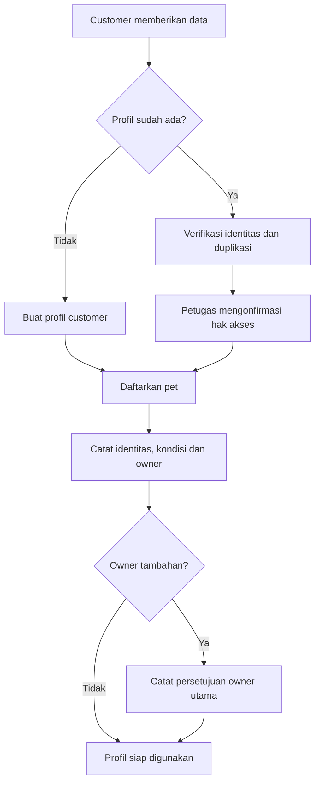
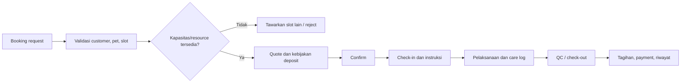

# 04 — Dokumen Proses Bisnis

**Status:** Alur usulan yang perlu disetujui pemilik operasional. Detail pembayaran, pajak, dan approval masih TBD.

## 1. Prinsip operasional

Semua transaksi mengidentifikasi cabang dan actor. Approval dipisahkan dari pembuat transaksi bila policy memerlukannya. Record historis tidak dihapus untuk memperbaiki kesalahan; gunakan pembatalan, retur, refund atau reversal yang tercatat. Scope akses berlaku sama pada halaman, laporan dan API.

## 2. Customer dan pet



Data medis hanya diisi dalam konteks klinis oleh actor berwenang; customer hanya melihat bagian yang disetujui.

## 3. POS dan pembayaran

1. Kasir membuka cash session di cabang yang diizinkan dan merekam saldo pembuka.
2. Tambahkan produk/layanan ke order; server memvalidasi item aktif, harga, eligibility promo, stok/capacity dan branch.
3. Tampilkan ringkasan item, diskon, pajak/fee terkonfigurasi serta total. Tarif dan pembulatan harus disetujui bisnis.
4. Simpan order dengan idempotency protection; alokasikan satu atau lebih pembayaran.
5. Pembayaran sukses mengubah saldo/order status; item inventory menghasilkan stock movement. Pending gateway payment menunggu callback yang diverifikasi.
6. Receipt dibuat dan dapat dicetak; gangguan printer tidak membatalkan transaksi.
7. Refund/void/retur mengikuti approval yang ditetapkan, membuat reversal/payment refund dan movement balik sesuai kondisi barang.
8. Kasir tutup sesi, hitung aktual, rekonsiliasi selisih; supervisor review exception.

```mermaid
sequenceDiagram
  actor Kasir
  participant UI as POS Web
  participant API as Backend
  participant DB as Database
  participant Pay as Payment Adapter (opsional)
  Kasir->>UI: Submit order dan metode bayar
  UI->>API: POST order + idempotency key
  API->>DB: Validasi scope, harga, stok; simpan order
  API->>DB: Buat payment/allocation
  alt Pembayaran lokal berhasil
    API->>DB: Finalisasi dan catat movement
  else Provider eksternal
    API->>Pay: Buat payment intent
    Pay-->>API: Pending/result
    API->>DB: Simpan hasil dan reference
  end
  API-->>UI: Status dan receipt
```

## 4. Purchasing, receiving, transfer

### Pembelian dan penerimaan

Purchase request (bila digunakan) → PO draft → submit → approval sesuai threshold → kirim ke supplier → penerimaan barang dengan kuantitas/batch/expiry aktual → rekonsiliasi item terhadap PO → terima parsial atau penuh → update ledger → cocokkan invoice → catat AP dan payment. Selisih harga/kuantitas menjadi exception; penerimaan berlebih ditahan sampai policy disetujui.

### Transfer cabang/gudang

Request menyebut origin/destination, barang dan jumlah → approval → reservasi/keluarkan barang dari sumber → transit → konfirmasi penerimaan tujuan → ledger pada kedua sisi dan selisih → tutup. Stok tidak boleh hilang selama transit; model akun transit dan ownership perlu ditetapkan saat database refinement.

## 5. Booking, grooming, hotel dan daycare

Customer/staf memilih pet, service, lokasi, rentang waktu dan add-on → availability check server-side → quote/deposit sesuai policy → konfirmasi → reminder → check-in. Grooming menambahkan catatan kondisi dan foto, assignment, checklist, pengerjaan, QC, completion, billing. Hotel/daycare menambahkan room/capacity, feeding/medication/activity logs dan check-out. Pembatalan/no-show/extension mengubah capacity serta biaya hanya sesuai aturan bisnis yang telah disetujui.



## 6. Veterinary dan resep

Booking/registrasi pasien → validasi owner dan consent → antrean → dokter mencatat anamnesis, pemeriksaan, vital, diagnosis, SOAP dan plan → consent tindakan bila diperlukan → resep/tindakan/vaksin/lab/rawat inap → dokter menandatangani/finalisasi → farmasi memeriksa resep dan batch → dispensing → kontrol lanjutan dan billing. Koreksi rekam medis memakai addendum dengan identitas actor; catatan yang ditandatangani tidak ditimpa. Ruang akses customer ke rekam medis memerlukan approval kebijakan.

## 7. Payment, refund dan finance

Payment dapat tunai, transfer, gateway, atau metode terkonfigurasi; daftar provider belum dipilih. Webhook tidak dianggap valid sebelum signature dan referensi diverifikasi. Reconciliation membandingkan order, alokasi, settlement dan kas. Refund membalik nilai yang valid, terhubung ke pembayaran asal dan membutuhkan alasan/approval sesuai kebijakan TBD. Pengeluaran, AP/AR, pajak, jurnal dan periode akuntansi mengikuti keputusan finance; jangan membuat jurnal final berdasarkan asumsi dokumen.

## 8. Cabang, customer portal dan approval

- Semua operasi mengambil cabang dari konteks terotorisasi; klien tidak dapat memilih cabang di luar assignment.
- Laporan pusat menggabungkan cabang hanya jika role memiliki scope yang sesuai.
- Customer portal hanya menampilkan data customer-owned/authorized.
- Approval mencatat requester, approver, waktu, keputusan dan alasan; konflik self-approval perlu policy eksplisit.

## 9. Failure dan exception handling

Jika timeout provider, jangan menandai pembayaran sukses; simpan state pending/retry dengan idempotency dan reconciliation. Jika stock/booking concurrency conflict, tolak tanpa partial mutation atau jelaskan status yang dapat dipulihkan. Jika file/notification gagal, transaksi inti tetap tersimpan dan kegagalan dicatat. SOP operasional pengguna ada di [manual](../06-PRODUCTION/19-USER-MANUAL-SOP.md).
