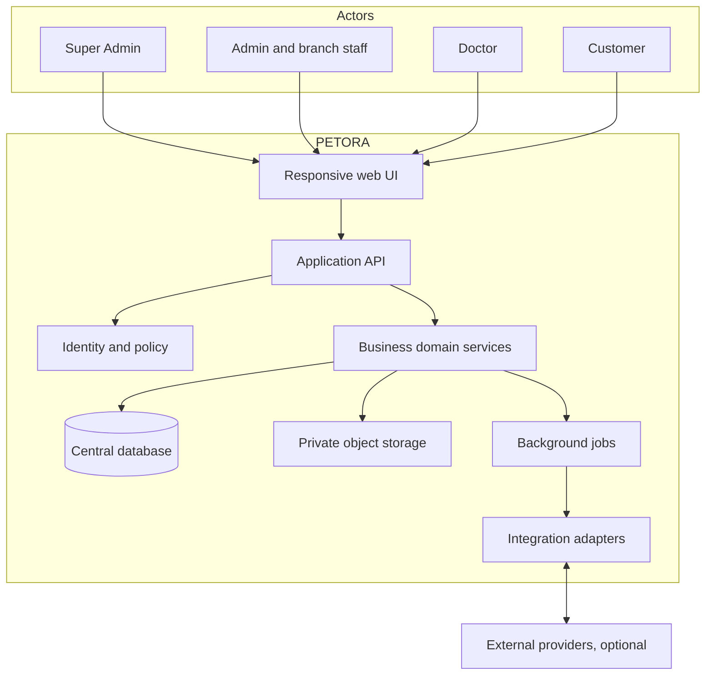
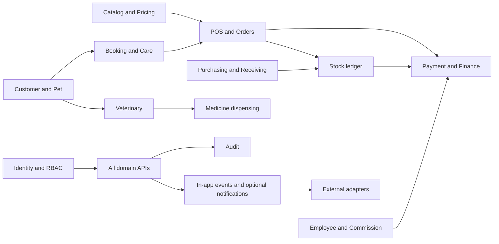

# 05 — System Blueprint

**Status:** Rancangan domain netral teknologi; tidak ada implementasi yang ditemukan saat audit.

## 1. Batas dan konteks sistem

PETORA melayani satu organisasi dengan satu sumber data terpusat dan banyak cabang. Pengguna mengakses web application melalui browser. Backend adalah batas otoritatif untuk business rules, authorization, validasi, audit dan koneksi provider. Provider eksternal berada di luar boundary dan hanya digunakan melalui adapter opsional.

## 2. Bounded domains dan ownership

| Domain | Data ownership / sumber kebenaran | Dependensi |
|---|---|---|
| Identity & Access | users, protected/custom roles, permissions, sessions, branch assignments | Semua domain |
| Organization | business settings, branches, branch settings, warehouses | Identity, transaksi |
| Customer & Pet | customer, addresses, pets, ownership/consent, contact preference | Booking, POS, veterinary |
| Catalog & Pricing | products/services, variants, units, price history, promotion rules | POS, stock, booking |
| Sales & Payments | orders, order items, allocations, payments, refunds, cash sessions | Catalog, inventory, finance |
| Inventory & Procurement | warehouses, batches, movements, transfer, supplier, purchase and receipt | Sales, catalog, finance |
| Pet Care | grooming, hotel, daycare, home service, transport, booking | Customer/pet, branch/resources |
| Clinical & Pharmacy | appointment, medical encounter, prescription, vaccination, batch dispensing | Customer/pet, pharmacy, finance |
| People | employees, work schedules, attendance, leave, commission | Identity, booking, finance |
| Finance & Accounting | cash, expense, AP/AR, journal, periods, reconciliation | Semua transaksi yang disetujui |
| Communication | in-app notification, templates, delivery attempt | Domain events, integrations |
| Integration | provider registry, encrypted configuration reference, execution logs | Backend services |
| Audit & Reporting | audit history and authorized aggregates | Semua domain |

## 3. Layer dan dependency rules

1. **Presentation:** responsive pages/components; client-side validation hanya untuk UX.
2. **API/application:** authentication, authorization, parsing, idempotency, orchestration, response.
3. **Domain:** state transitions, pricing/stock/capacity policies, validation, event generation.
4. **Persistence:** relational transactions, constraints, repository/query boundaries.
5. **Infrastructure:** private file storage, queue, secrets management, provider adapters, telemetry.

UI tidak boleh mengakses database atau provider langsung. Domain transaction diproses backend dan perubahan terkait disimpan atomik. Reporting menggunakan query/view yang menerapkan policy scope; laporan bukan jalur bypass permission.

## 4. Arsitektur cabang

- User dapat memiliki satu atau lebih branch assignments; permission menentukan tindakan dan scope.
- Record operasional memiliki `branch_id`. Master global memiliki scope global eksplisit; master spesifik cabang menggunakan tabel konfigurasi/junction.
- Transfer mempunyai branch asal dan tujuan; approval/transit/receipt dicatat pada dokumen transfer.
- Cross-branch report hanya untuk role dengan scope yang sesuai.
- Tidak ada `tenant_id`, tenant subscription, ataupun isolasi antar-organisasi.

## 5. Interaksi domain

## 6. Cross-cutting patterns

- **Transaction boundary:** order/payment allocation, goods receipt/stock movement, transfer receipt, dispensing/medicine movement, journal post.
- **Idempotency:** payment creation/callback, webhook event processing, order submission, stock posting, import jobs.
- **Audit:** actor, resource, action, result, timestamp and correlation ID; data minimization applies.
- **Files:** metadata linked to domain record, private storage, scoped download, retention TBD.
- **Integration:** registry of supported connectors; new provider/protocol requires backend adapter implementation.
- **Consistency:** ledger tables are append-only for stock, loyalty and posted financial events; correction uses compensating entries.

## 7. Operational boundaries

Database vendor, frontend/backend framework, hosting, identity provider, queue, observability and storage are TBD. Architecture decisions must be recorded before stack-specific design; see [technical architecture](./09-TECHNICAL-ARCHITECTURE.md) and [decision log](../00-DOCUMENT-CONTROL/23-DECISION-LOG-ASSUMPTIONS.md).
