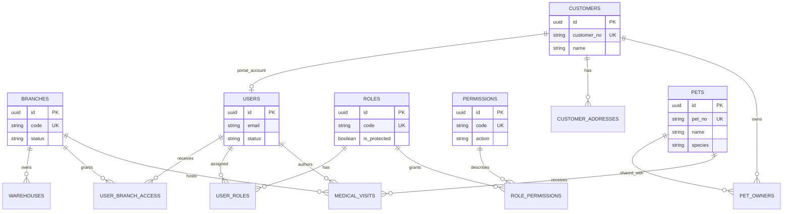
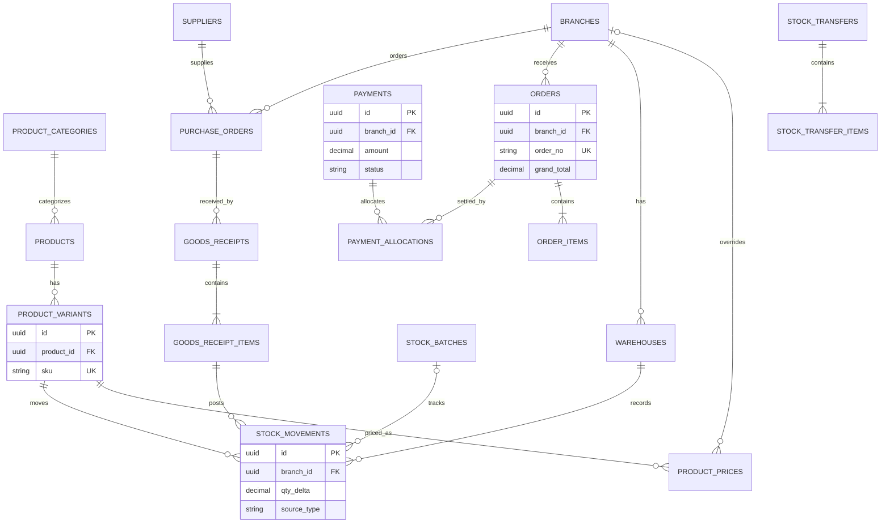
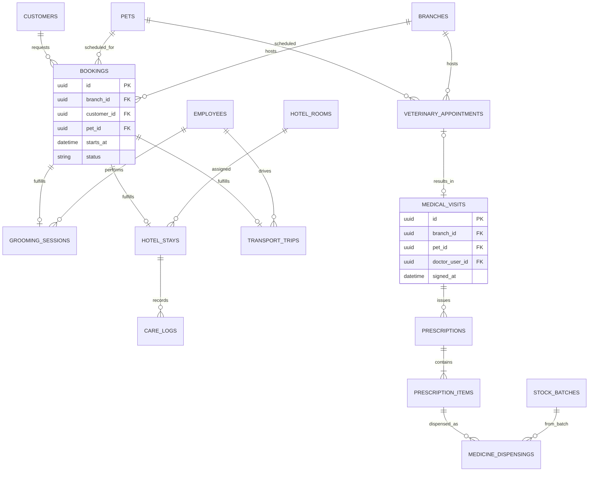
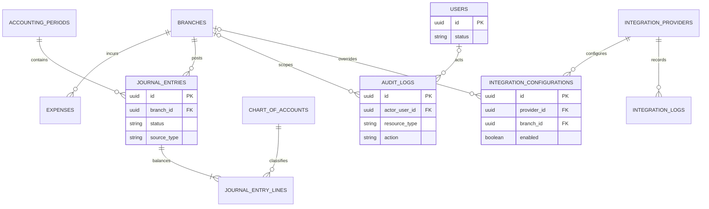

# 07 — Entity Relationship Diagram

Diagram ini merepresentasikan model konseptual yang dirinci pada [Database Design](./06-DATABASE-DESIGN.md). Semua nama adalah proposal; bukan hasil inspeksi database implementasi.

## 1. Organization, access, customer dan pet

## 2. Product, stock, sales dan purchasing

## 3. Booking, layanan dan klinik

## 4. Finance, audit dan integrations

## 5. Catatan konsistensi

- Semua relation multi-cabang mengarah ke `branches`; transfer memiliki origin/destination branch, bukan FK cabang tunggal.
- Pet ownership adalah many-to-many melalui `pet_owners`; consent adalah bagian penting dari policy, dapat diekstrak ke tabel consent/event saat desain rinci.
- Diagram tidak menampilkan seluruh kolom maupun junction; silakan gunakan desain database untuk referensi detail.
- ERD final harus divalidasi dengan migration, constraint, dan definisi branch scope sebelum implementasi.
