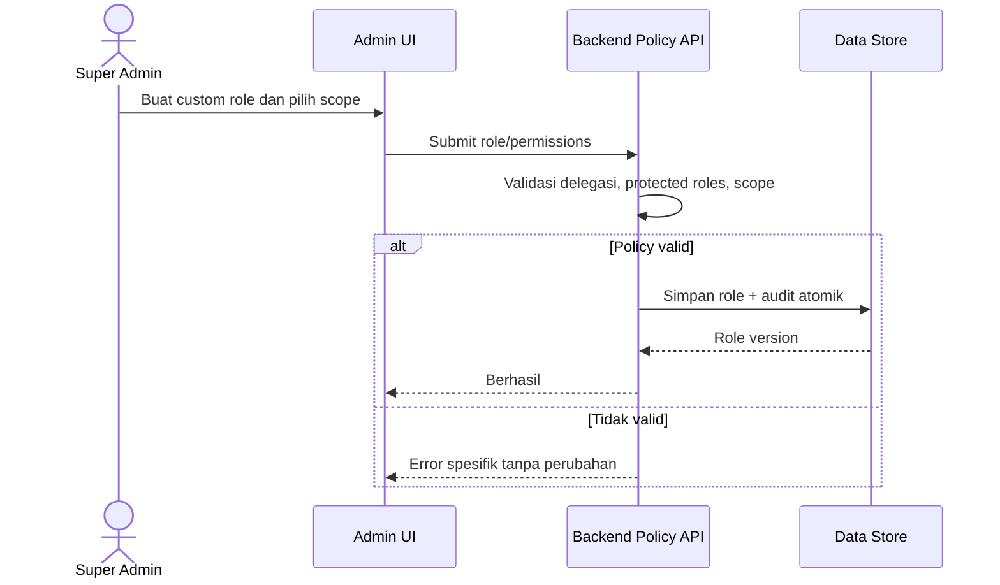

# 13 — User Flow dan Use Case

## 1. Aktor

| Aktor | Tujuan / batas |
|---|---|
| Super Admin | Konfigurasi organisasi, role, cabang dan integrasi |
| Admin/Manager | Mengelola operasi yang didelegasikan di cabang/data scope |
| Kasir | POS, pembayaran, sesi kas |
| Staf inventory/purchasing | Stock ledger, PO, penerimaan dan transfer |
| Groomer/care staff/driver | Menyelesaikan pekerjaan yang ditugaskan |
| Dokter | Appointment dan tindakan/rekam klinis yang diizinkan |
| Finance/accountant | Rekonsiliasi, expense, AP/AR dan jurnal sesuai kebijakan |
| Customer | Mengelola data sendiri dan booking/order |
| Provider | Sistem eksternal opsional yang berkomunikasi melalui adapter |

## 2. Use case ringkas

| ID | Use case | Aktor utama | Prasyarat | Hasil |
|---|---|---|---|---|
| UC-01 | Mengelola role dan akses cabang | Super Admin | Authenticated, policy valid | Role/permission version tersimpan dan diaudit |
| UC-02 | Membuat order dan menerima pembayaran | Kasir | Shift aktif, branch authorized | Order, allocations, payment dan movement konsisten |
| UC-03 | Menerima PO | Purchasing | PO approved | Receipt dan stock ledger ditulis |
| UC-04 | Memesan layanan | Customer/CS | Pet authorized, slot tersedia | Booking pending/confirmed sesuai payment policy |
| UC-05 | Menjalankan grooming | Groomer | Booking confirmed/assigned | Checklist, QC, completion dan histori |
| UC-06 | Melakukan konsultasi | Dokter | Patient/appointment authorized | Medical encounter tercatat dan ditandatangani |
| UC-07 | Dispense obat | Farmasi | Prescription valid dan batch available | Dispensing dan stock movement |
| UC-08 | Mengakses laporan cabang | Manager/Finance | Report permission dan scope | Agregat sesuai scope dan filter |
| UC-09 | Mengonfigurasi connector | Super Admin | Adapter tersedia | Config encrypted, tested, enabled/disabled |
| UC-10 | Refund order | Supervisor/Kasir berizin | Payment settled, approval rule dipenuhi | Refund terkait payment asal, audit dan reversal |

## 3. Flow pengelolaan akses

## 4. Main/alternative/exception flows

### UC-02 — POS dan pembayaran

1. Kasir membuka shift, sistem menolak jika tidak authorized atau shift konflik.
2. Kasir menambahkan item, server memvalidasi SKU, price, promo dan stok.
3. Sistem menunjukkan total yang dihitung server.
4. Kasir submit dengan idempotency key.
5. Sistem menyimpan order; menerima satu/lebih payment allocations.
6. Setelah status payment terverifikasi, order dan stock movements difinalisasi.
7. Receipt ditampilkan/cetak.

**Alternatif:** pembayaran sebagian → order open balance; gateway asynchronous → pending hingga webhook/reconciliation.  
**Exception:** stok tidak cukup, price berubah, branch tidak berhak, duplicate request, gateway timeout atau approval refund tidak ada → tidak mengklaim sukses; tampilkan status/aksi lanjut.

### UC-04 — Booking

Customer memilih pet, service, branch dan slot; sistem validasi owner, kapasitas, jam, resource dan deposit policy. Slot di-reserve atomik; customer menerima status dan notifikasi. Slot penuh menawarkan alternatif, bukan membuat booking yang melebihi kapasitas. Pembatalan/no-show mengikuti policy TBD.

### UC-06 — Clinical encounter

Dokter membuka appointment yang assigned, memverifikasi pasien/owner, mencatat anamnesis/vitals/SOAP, diagnosis, treatment, consent, prescription atau follow-up, lalu sign. Koreksi setelah sign dicatat sebagai addendum. Customer access menggunakan medical data policy.

## 5. Role-specific journeys

- **Super Admin:** login → dashboard global → atur cabang/user/role → konfigurasi adapter → audit status.
- **Admin cabang:** login → pilih konteks cabang yang permitted → dashboard → proses operasional → approval/laporan sesuai delegation.
- **Dokter:** clinical queue → encounter → prescription/procedure → follow-up.
- **Customer:** login → profile/pet → booking/checkout → lihat status/pembayaran → layanan milik sendiri.

## 6. Error paths dan pemulihan

Session expired meminta login ulang tanpa mengirim ulang command non-idempotent secara otomatis. Konflik concurrent slot/stok mengembalikan state terbaru. Provider unavailable menyimpan pekerjaan pending bila aman dan memicu rekonsiliasi. Upload gagal tidak membuat record seolah ada file. Semua flow mengikuti kontrak [API](../02-ARCHITECTURE/08-API-SPECIFICATION.md).
