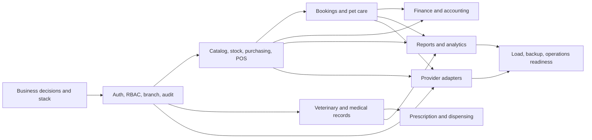

# 15 — Development Roadmap

**Status:** Urutan awal yang perlu reprioritisasi stakeholder; tanggal, kapasitas tim dan release target belum tersedia.

## 1. Prinsip prioritas

Prioritaskan fondasi keamanan/integritas sebelum modul yang mengandalkannya. Gunakan vertical slices yang dapat diuji lintas UI/API/database. Jangan membuka production scope sebelum keputusan finansial, medis, branch policy, backup dan operasi disetujui.

## 2. Fase dan deliverable

| Fase | Outcome | Modul/deliverable | Exit gate |
|---|---|---|---|
| 0 — Discovery | Keputusan dan stack disepakati | Validasi Q-001–Q-012, threat model, architecture decision records, prototype transaksi concurrency | Approval domain/engineering; no critical TBD blocking build |
| 1 — Foundation | Akses dan cabang aman | Auth, protected roles, RBAC, branch assignment, audit, settings, CI/migrations | Negative authorization tests; recovery Super Admin; migration/backup smoke test |
| 2 — Retail core | Penjualan dan stok dapat direkonsiliasi | Customer/pet, catalog, warehouse, movements, supplier/PO, POS/payment/cash | Idempotent checkout; stock reconciliation; refund policy tested |
| 3 — Service operations | Booking dan eksekusi layanan | Availability, grooming, hotel/daycare, transport, portal basics | Concurrent capacity, branch schedule, staff workflows tested |
| 4 — Veterinary | Catatan klinis dan farmasi terlindungi | Appointments, encounter, consent, prescription, batches/dispensing | Medical access boundary and history/audit reviewed by clinician |
| 5 — Management | Pelaporan dan people/finance | Attendance, commission, expenses, AP/AR, accounting if approved, reports, loyalty | Finance reconciliation, report scope, accounting policy signed |
| 6 — Integrations & scale | Provider dan production readiness | Selected adapters, webhook, observability, load, resilience, restore | Provider sandbox/contract test, load target and disaster recovery passed |

## 3. Dependency graph

## 4. Risiko dan mitigasi

| Risiko | Mitigasi |
|---|---|
| Scope seluruh domain terlalu besar | Release modular, define MVP oleh owner, measure WIP |
| Kebijakan pajak/refund belum ada | Block financial acceptance sampai disetujui |
| Data medis sensitif | Review dokter/privacy owner dan negative tests sebelum portal |
| Race condition booking/stok | Prototype atomic reservation/movement early |
| Provider gagal/berganti | Adapter contract, idempotency, fallback/manual process |
| Migrasi data belum diketahui | Inventory legacy source dan reconciliation plan sebelum cutover |
| Tidak ada stack/ops | Architecture decision gate dan operational owner sebelum build |

## 5. Definition of Done dan release

Feature selesai bila requirement/FRD/API/data/UI/test/permission/traceability diperbarui; review code dan security; migration aman; unit/integration/UI test sesuai; accessibility/responsive check; logs/metrics/alerts; dokumentasi/SOP; rollback/feature flag bila relevan; acceptance owner tercatat. Release bertahap ke test/staging, UAT per role/cabang, pilot cabang, kemudian rollout dengan monitoring dan rollback plan. Jadwal dan cutover perlu keputusan.
