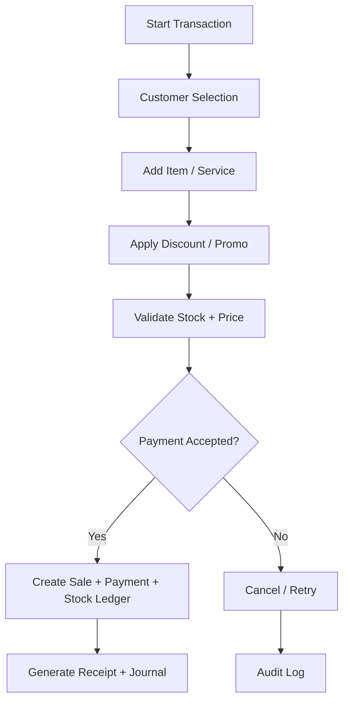

# Business Processes

Dokumen ini merangkum proses utama yang berlangsung di PETORA, termasuk trigger, actor, alur utama, flow alternatif, failure flow, dan aturan akses.

## 1. Proses Checkout POS

- Trigger: kasir mulai transaksi penjualan produk atau layanan
- Aktor: kasir, customer, supervisor, inventory, finance
- Initial state: keranjang kosong, user login valid, branch aktif
- Main flow:
  1. Pelanggan dipilih atau ditambahkan.
  2. Produk atau layanan dipilih dan kuantitas diinput.
  3. Diskon, voucher, pajak, dan biaya layanan dihitung.
  4. Metode pembayaran dipilih dan divalidasi.
  5. Sistem memeriksa ketersediaan stok dan hak akses.
  6. Untuk pembayaran tunai, kasir mencatat tender; untuk provider eksternal, sistem membuat payment attempt dengan idempotency reference dan menunggu hasil terverifikasi.
  7. Setelah payment success terkonfirmasi, sistem menyelesaikan sale, payment, stock ledger, loyalty event, dan journal posting dalam satu transaksi database internal.
  8. Notifikasi/struk dikirim melalui outbox atau mekanisme retryable setelah commit; sistem tidak menganggap pemanggilan provider dan commit database sebagai satu transaksi atomik.
- Alternative flow: pembayaran campuran, pembayaran sebagian bila policy mengizinkan, atau voucher/loyalty redemption.
- Failure flow: stok tidak cukup, metode pembayaran gagal/timeout, webhook tidak valid/duplikat, harga diubah oleh pengguna tidak berwenang, atau data pelanggan tidak valid. Timeout masuk status pending/reconciliation dan tidak boleh membuat efek transaksi ganda.
- Data created/updated: `sales_transactions`, `sale_items`, `payments`, `stock_ledgers`, `loyalty_events`, `journal_entries`; payment attempts, stock reservations, dan outbox entities masih perlu finalisasi schema.
- Hak akses: kasir dapat melakukan checkout; refund/void memerlukan otorisasi supervisor atau owner.

## 2. Proses Refund dan Pembatalan

- Trigger: pelanggan meminta refund, retur, atau pembatalan transaksi
- Aktor: kasir, supervisor, finance, customer service
- Main flow:
  1. Refund atau void diajukan dengan alasan dan dokumen pendukung.
  2. Sistem memeriksa status transaksi, item, metode payment, jumlah yang dapat dikembalikan, dan batas policy aktif.
  3. Otorisasi dan approval dijalankan sesuai role, limit, dan separation-of-duties policy.
  4. Untuk provider eksternal, refund dikirim sebagai idempotent provider request dan dipantau sampai hasil final; timeout tidak dianggap berhasil.
  5. Setelah hasil terkonfirmasi, koreksi payment, stok yang benar-benar kembali, loyalty event, dan jurnal dibuat secara konsisten dalam transaksi database internal.
  6. Pelanggan menerima konfirmasi setelah status final; seluruh tahapan tetap dapat direkonsiliasi.
- Failure flow: transaksi tidak ditemukan, sudah lewat batas waktu, jumlah refund melebihi saldo, provider gagal/timeout, atau stock tidak dapat dikembalikan. Tidak boleh menghapus sale asli.
- Data created/updated: `sales_transactions`, `payments`, `journal_entries`, `loyalty_events`, `stock_ledgers`; `refund_requests`/refund attempts adalah entity kandidat yang perlu didefinisikan.

## 3. Proses Penerimaan Barang dan Pembelian

- Trigger: purchase order diterima dari supplier atau barang datang ke gudang
- Aktor: purchasing, inventory, warehouse, finance
- Main flow:
  1. PO dibuat dan disetujui.
  2. Barang diterima dan diverifikasi dengan dokumen supplier dan kualitas.
  3. Batch, expiry, dan SKU dicocokkan.
  4. Stok bertambah melalui stock ledger dan barang masuk.
  5. Invoice ditandingkan dengan PO dan penerimaan.
  6. Hutang usaha dan jurnal keuangan dibuat.
- Failure flow: quantity mismatch, barang rusak, invoice tidak cocok, invoice duplicate.

## 4. Proses Stock Opname dan Koreksi Stok

- Trigger: opname periodik atau kebutuhan penyesuaian stok
- Aktor: inventory staff, supervisor, manager
- Main flow:
  1. Penghitungan fisik dilakukan untuk SKU tertentu.
  2. Selisih hitung dipantau dan disetujui.
  3. Sistem menambahkan stock adjustment dengan reason code.
  4. Stock ledger, jurnal persediaan, dan perubahan nilai inventaris dibuat.
- Failure flow: selisih terlalu besar, tanpa approval, atau status barang rusak/karantina.

## 5. Proses Grooming dan Booking Layanan

- Trigger: pelanggan mendaftar booking atau walk-in
- Aktor: customer service, groomer, supervisor
- Main flow:
  1. Booking dibuat dengan layanan, hewan, cabang, dan jadwal.
  2. Kapasitas dipastikan.
  3. Petugas ditugaskan dan kebutuhan hewan dicek.
  4. Check-in dilakukan dan kondisi hewan dicatat.
  5. Proses grooming berjalan dengan checklist.
  6. Hasil layanan, foto, dan catatan tambahan dicatat.
  7. Pembayaran final dan riwayat layanan dibangun.
- Failure flow: jadwal bentrok, no-show, atau layanan dibatalkan.

## 6. Proses Pemeriksaan Klinik dan Resep

- Trigger: pasien datang untuk konsultasi atau follow-up
- Aktor: vet, nurse, pharmacist, owner, customer service
- Main flow:
  1. Pasien didaftarkan dan antrean diperiksa.
  2. Triage dan pemeriksaan dilakukan.
  3. Diagnosis, tindakan, dan resep dibuat oleh dokter.
  4. Jika perlu, obat dikeluarkan dari farmasi berdasarkan resep valid.
  5. Rekam medis diperbarui dan disimpan sebagai snapshot + revision history.
  6. Tagihan dibuat dan pembayaran diproses.
- Failure flow: pasien alergi, resep tidak valid, obat dibatasi, atau tindakan medis membutuhkan consent.

## 7. Proses Pet Hotel / Boarding dan Check-in Check-out

- Trigger: pelanggan melakukan reservasi kamar atau penitipan
- Aktor: staff hotel, manager, owner
- Main flow:
  1. Reservasi dibuat dan kapasitas diperiksa.
  2. Check-in dilakukan dengan profil kebutuhan hewan.
  3. Pemberian makan, obat, dan monitoring dilakukan sepanjang masa penitipan.
  4. Check-out menghasilkan laporan perkembangan, pembayaran, dan riwayat penitipan.
- Failure flow: keterlambatan, dokumentasi tidak lengkap, kondisi hewan darurat, atau fasilitas rusak.

## 8. Proses Keuangan dan Jurnal

- Trigger: transaksi, pembayaran, refund, atau pembukuan harian
- Aktor: finance, accounting, manager
- Main flow:
  1. Event keuangan dibuat berdasarkan transaksi.
  2. Jurnal umum dan jurnal pembantu dibuat.
  3. Reconciliation dilakukan berdasarkan kas, bank, atau metode pembayaran.
  4. Penutupan periode diuji keseimbangan jurnal.
  5. Laporan keuangan diproduksi.
- Failure flow: jurnal tidak balance, piutang atau hutang tidak seimbang, atau transaksi belum lengkap.

## 9. Proses Multi-Cabang dan Konsolidasi

- Trigger: aktivitas organisasi terjadi di satu atau beberapa cabang
- Aktor: owner, manager pusat, admin
- Main flow:
  1. Setiap operasi diarahkan ke branch scope yang valid.
  2. Data diproses di cabang masing-masing.
  3. Data konsolidasi di-aggregate di dashboard pusat.
  4. Laporan perusahaan dibuat berdasarkan organisasi dan cabang.
- Failure flow: akses cabang tidak valid, data tidak konsisten, atau laporan tidak sesuai scope.

## 10. Membership, Loyalty, and Promotion

- **Trigger:** customer membeli membership, memperoleh/menukar loyalty, atau kasir menerapkan promo.
- **Aktor:** customer service, cashier, marketing/admin, finance reviewer.
- **Prasyarat:** customer aktif dan terverifikasi; program/promo aktif pada organization/branch; policy version berlaku pada waktu transaksi.
- **Alur utama:** sistem menentukan eligibility dan harga/promo dari server → menampilkan benefit/discount yang berlaku → customer menyetujui → transaksi menyimpan snapshot rule, membership/loyalty reference, dan nilai yang dihitung → setelah sale completed, loyalty event ditambahkan satu kali.
- **Alternatif:** promo tidak memenuhi syarat ditolak dengan alasan aman; redemption hanya dilakukan jika saldo tersedia dan limit policy mengizinkan.
- **Koreksi/refund:** refund/void membuat reversal loyalty/benefit event yang mengacu ke event asal; saldo tidak diedit langsung.
- **Failure flow:** program expired, branch mismatch, promo stacking conflict, saldo berubah bersamaan, retry duplikat; transaksi tidak menggunakan aturan dari cache/browser sebagai kebenaran.
- **Data/output:** `memberships`, `loyalty_events`, `promotions`, `promo_rules`, sale price snapshot; schema detail membership/benefit masih perlu disahkan.
- **Akses/test:** pelanggan hanya melihat benefit miliknya; perubahan rule memerlukan permission/approval. PET-REQ-010/011; PET-TST-015/016.

## 11. Attendance, Commission, and Payroll

- **Trigger:** staff clock-in/out, koreksi absensi, atau payroll period dibuka/ditutup.
- **Aktor:** employee, supervisor, HR, payroll reviewer, finance approver.
- **Alur utama:** staff mencatat waktu/shift → sistem memvalidasi assignment dan waktu server → exception (lupa clock-out, shift swap, leave) dibuat sebagai request dengan bukti/alasan → supervisor/HR menyetujui koreksi → payroll period mengambil snapshot attendance, commission dan aturan yang disetujui → HR meninjau itemized calculation → approver menyahkan → finance mengeksekusi pembayaran dan posting sumber jurnal.
- **Alternatif:** perubahan rule komisi selama period tidak mengubah transaksi yang sudah menyimpan snapshot; dibuatkan adjustment yang dapat ditelusuri.
- **Failure flow:** data absensi hilang, employee tidak aktif, formula belum disetujui, period telah ditutup, atau posting tidak seimbang; payroll tetap draft dan tidak dibayar.
- **Data/output:** `employees`, `attendance`, `commissions`, `payroll_cycles`, `payroll_records`, audit dan payment/journal references. Pajak, statutory deductions, overtime formula, approval limit dan exact retention menunggu keputusan owner/legal.
- **Akses/test:** HR/finance data dibatasi per organization/assignment; export payslip diaudit. PET-REQ-012; PET-TST-017.

## 12. Customer Portal and Notification

- **Trigger:** customer masuk, mengelola pet, membuat booking, melihat transaksi yang diizinkan, atau menerima reminder.
- **Aktor:** customer, customer service, notification service/provider.
- **Alur utama:** authentication mengikat user ke customer identity → API mengecek pet ownership/consent → customer mengirim booking/change request → server menyimpan request dan status authoritative → notification outbox dijadwalkan → adapter mengirim pesan sesuai preference/consent → delivery attempt dan provider reference dicatat.
- **Alternatif:** perubahan yang perlu staff review menjadi `pending`, bukan langsung aktif; customer dapat mengubah preferensi/opt-out sesuai policy.
- **Failure flow:** customer-to-user link tidak valid, consent tidak ada, provider timeout/rate limit, duplicate event, atau message ditolak; data portal tetap dapat dilihat sesuai izin dan status pengiriman tidak dianggap sukses.
- **Data/output:** `customer_portal_access`, booking/customer-owned records, `notifications`, delivery attempts/outbox candidate entities. Payload provider diminimalkan.
- **Akses/test:** customer tidak dapat mengakses pet milik akun lain, internal notes, payroll, atau clinical fields yang tidak disetujui. PET-REQ-015/018; PET-TST-019/020.

## 13. System Settings Proposal and Approval

- **Trigger:** Super Admin mengubah policy yang terdaftar dalam key catalog.
- **Aktor:** Super Admin proposer, Owner/approver, server-side settings service.
- **Alur utama:** pilih organization/branch context → baca active value/version → ubah nilai dan alasan → server memvalidasi key/type/range/scope/permission/lock → sistem menyimpan proposal dengan `expected_version_no` → jika approval diperlukan, Owner meninjau diff/dampak/alasan → server menolak self/stale/unauthorized approval sesuai policy → approval, active value update, version dan audit commit dalam satu transaksi.
- **Alternatif:** setting non-critical yang disahkan policy dapat aktif melalui workflow yang sama tanpa second approver; decision dan audit tetap tercatat.
- **Failure flow:** schema tidak valid, lock, role/scope mismatch, missing reason, expected version stale, approval ditolak, atau transaction gagal; active value tidak berubah.
- **Data/output:** `system_settings`, `setting_change_requests`, `setting_versions`, `setting_audit_log`; runtime hanya membaca active version.
- **Akses/test:** frontend menggunakan Settings API, bukan direct table mutation. PET-REQ-016/018; PET-TST-SET-* dan PET-TST-SEC-SET-*.

## 14. Consignment and Settlement

- **Trigger:** mitra menyerahkan barang titipan, barang terjual/retur, atau periode settlement tiba.
- **Aktor:** inventory staff, cashier, finance, consignment partner representative.
- **Alur utama:** validasi kontrak/partner dan barang → receiving mencatat custody, kuantitas, kondisi dan lokasi → sale menandai unit/line sebagai consignment sesuai ownership → periode settlement menghitung sold/returned/damaged quantity dan hak mitra berdasarkan kontrak yang berlaku → finance mereview rekonsiliasi dan menyetujui pembayaran → settlement/payment/journal reference disimpan.
- **Alternatif:** retur barang tidak terjual dan barang rusak menggunakan reason/approval; perbedaan stok masuk exception queue.
- **Failure flow:** kontrak/beneficiary tidak valid, kuantitas tidak reconcile, harga/commission rule berubah, invoice duplicate, atau payout gagal; settlement tetap pending dan tidak menutup selisih secara manual.
- **Data/output:** candidate entities `consignment_partners`, `consignment_stock`, `settlements`, stock ledger, sales and finance records. Kepemilikan stok, revenue recognition, margin split, pajak, dan settlement cycle memerlukan keputusan finance/legal.
- **Akses/test:** purchasing/inventory dapat mengelola custody; payout memerlukan finance approval. PET-FTR-028 dan PET-REQ-013; skenario test detail ditambahkan saat feature disetujui untuk release.

## Business Rules Summary

- Semua proses kritis harus dipastikan tercatat di audit log.
- Data finansial dan medis tidak boleh dihapus sepihak.
- Scope data berdasarkan organisasi dan cabang harus selalu diverifikasi sebelum operasional.
- Mutasi database dalam satu domain workflow harus atomik; provider eksternal ditangani sebagai state machine/idempotent workflow dengan reconciliation atau compensation, bukan diasumsikan ikut transaksi PostgreSQL.
- Setiap proses memiliki actor, organization/branch scope, state transition, reason, audit evidence, dan test scenario.
- Status `pending`, `failed`, `cancelled`, dan `reversed` harus dibedakan dari `completed` untuk payment, booking, approval, dan provider operation.

## Related Documents

- [feature-catalog.md](../01-product/feature-catalog.md)
- [user-roles.md](user-roles.md)
- [permission-matrix.md](permission-matrix.md)
- [business-rules.md](business-rules.md)

