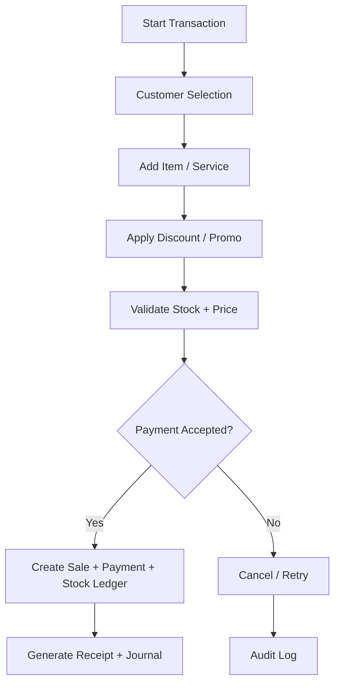
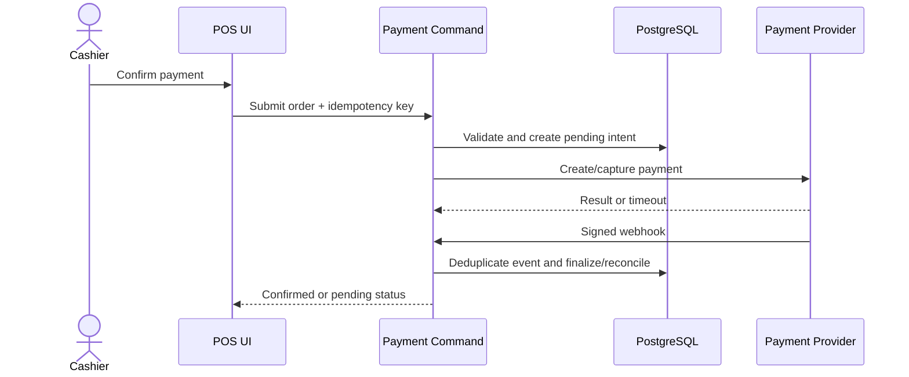

# Business Processes

Dokumen ini merangkum proses utama yang berlangsung di PETORA, termasuk trigger, actor, alur utama, flow alternatif, failure flow, dan aturan akses.

## 1. Proses Checkout POS

- Trigger: kasir mulai transaksi penjualan produk atau layanan
- Aktor: kasir, customer, supervisor, inventory, finance
- Initial state: keranjang kosong, user login valid, branch aktif
- Main flow:
  1. Pelanggan dipilih atau ditambahkan.
  2. Produk atau layanan dipilih dan kuantitas diinput.
  3. Diskon, voucher, pajak, dan biaya layanan dihitung.
  4. Metode pembayaran dipilih dan divalidasi.
  5. Sistem memeriksa ketersediaan stok dan hak akses.
  6. Payment gateway atau cash acceptance diproses.
  7. Stock ledger, sales transaction, payment, loyalty, dan jurnal keuangan dibuat dalam transaksi yang atomik.
  8. Struk dan invoice dibuat lalu diserahkan ke pelanggan.
- Alternative flow: pembayaran campuran, pembayaran sebagian, atau voucher/loyalty redemption.
- Failure flow: stok tidak cukup, metode pembayaran gagal, harga diubah oleh pengguna tidak berwenang, data pelanggan tidak valid.
- Data created/updated: sales, sale_items, payment_records, loyalty_records, stock_movements, journal_entries.
- Hak akses: kasir dapat melakukan checkout; refund/void memerlukan otorisasi supervisor atau owner.

## 2. Proses Refund dan Pembatalan

- Trigger: pelanggan meminta refund, retur, atau pembatalan transaksi
- Aktor: kasir, supervisor, finance, customer service
- Main flow:
  1. Refund atau void diajukan dengan alasan dan dokumen pendukung.
  2. Sistem memeriksa apakah transaksi sudah dibayar dan statusnya valid untuk refund.
  3. Otorisasi sesuai role dan policy.
  4. Saldo stok, poin loyalitas, dan jurnal keuangan dikoreksi secara konsisten.
  5. Pelanggan menerima konfirmasi refund atau penggantian.
- Failure flow: transaksi tidak ditemukan, sudah lewat batas waktu, atau stock tidak dapat dikembalikan.
- Data created/updated: refund_requests, refund_transactions, journal_entries, loyalty_adjustments, stock_return_records.

## 3. Proses Penerimaan Barang dan Pembelian

- Trigger: purchase order diterima dari supplier atau barang datang ke gudang
- Aktor: purchasing, inventory, warehouse, finance
- Main flow:
  1. PO dibuat dan disetujui.
  2. Barang diterima dan diverifikasi dengan dokumen supplier dan kualitas.
  3. Batch, expiry, dan SKU dicocokkan.
  4. Stok bertambah melalui stock ledger dan barang masuk.
  5. Invoice ditandingkan dengan PO dan penerimaan.
  6. Hutang usaha dan jurnal keuangan dibuat.
- Failure flow: quantity mismatch, barang rusak, invoice tidak cocok, invoice duplicate.

## 4. Proses Stock Opname dan Koreksi Stok

- Trigger: opname periodik atau kebutuhan penyesuaian stok
- Aktor: inventory staff, supervisor, manager
- Main flow:
  1. Penghitungan fisik dilakukan untuk SKU tertentu.
  2. Selisih hitung dipantau dan disetujui.
  3. Sistem menambahkan stock adjustment dengan reason code.
  4. Stock ledger, jurnal persediaan, dan perubahan nilai inventaris dibuat.
- Failure flow: selisih terlalu besar, tanpa approval, atau status barang rusak/karantina.

## 5. Proses Grooming dan Booking Layanan

- Trigger: pelanggan mendaftar booking atau walk-in
- Aktor: customer service, groomer, supervisor
- Main flow:
  1. Booking dibuat dengan layanan, hewan, cabang, dan jadwal.
  2. Kapasitas dipastikan.
  3. Petugas ditugaskan dan kebutuhan hewan dicek.
  4. Check-in dilakukan dan kondisi hewan dicatat.
  5. Proses grooming berjalan dengan checklist.
  6. Hasil layanan, foto, dan catatan tambahan dicatat.
  7. Pembayaran final dan riwayat layanan dibangun.
- Failure flow: jadwal bentrok, no-show, atau layanan dibatalkan.

## 6. Proses Pemeriksaan Klinik dan Resep

- Trigger: pasien datang untuk konsultasi atau follow-up
- Aktor: vet, nurse, pharmacist, owner, customer service
- Main flow:
  1. Pasien didaftarkan dan antrean diperiksa.
  2. Triage dan pemeriksaan dilakukan.
  3. Diagnosis, tindakan, dan resep dibuat oleh dokter.
  4. Jika perlu, obat dikeluarkan dari farmasi berdasarkan resep valid.
  5. Rekam medis diperbarui dan disimpan sebagai snapshot + revision history.
  6. Tagihan dibuat dan pembayaran diproses.
- Failure flow: pasien alergi, resep tidak valid, obat dibatasi, atau tindakan medis membutuhkan consent.

## 7. Proses Pet Hotel / Boarding dan Check-in Check-out

- Trigger: pelanggan melakukan reservasi kamar atau penitipan
- Aktor: staff hotel, manager, owner
- Main flow:
  1. Reservasi dibuat dan kapasitas diperiksa.
  2. Check-in dilakukan dengan profil kebutuhan hewan.
  3. Pemberian makan, obat, dan monitoring dilakukan sepanjang masa penitipan.
  4. Check-out menghasilkan laporan perkembangan, pembayaran, dan riwayat penitipan.
- Failure flow: keterlambatan, dokumentasi tidak lengkap, kondisi hewan darurat, atau fasilitas rusak.

## 8. Proses Keuangan dan Jurnal

- Trigger: transaksi, pembayaran, refund, atau pembukuan harian
- Aktor: finance, accounting, manager
- Main flow:
  1. Event keuangan dibuat berdasarkan transaksi.
  2. Jurnal umum dan jurnal pembantu dibuat.
  3. Reconciliation dilakukan berdasarkan kas, bank, atau metode pembayaran.
  4. Penutupan periode diuji keseimbangan jurnal.
  5. Laporan keuangan diproduksi.
- Failure flow: jurnal tidak balance, piutang atau hutang tidak seimbang, atau transaksi belum lengkap.

## 9. Proses Multi-Cabang dan Konsolidasi

- Trigger: aktivitas organisasi terjadi di satu atau beberapa cabang
- Aktor: owner, manager pusat, admin
- Main flow:
  1. Setiap operasi diarahkan ke branch scope yang valid.
  2. Data diproses di cabang masing-masing.
  3. Data konsolidasi di-aggregate di dashboard pusat.
  4. Laporan perusahaan dibuat berdasarkan organisasi dan cabang.
- Failure flow: akses cabang tidak valid, data tidak konsisten, atau laporan tidak sesuai scope.

## 10. Proses Payment dan Reconciliation

- Trigger: order siap dibayar atau provider mengirim webhook.
- Aktor: Cashier, Customer, Finance, Payment Provider, backend service.
- Initial state: order tervalidasi dan berstatus `pending_payment`; payment intent memiliki idempotency key.
- Main flow: server menghitung amount/currency -> membuat payment intent -> Edge Function mengirim provider request -> verified callback/event deduplicated -> transaction DB finalizes payment/sale/stock/journal -> receipt dan status dikirim.
- Alternative flow: split tender atau cash payment sesuai metode yang aktif; partial payment hanya jika policy bisnis telah disetujui.
- Failure flow: provider decline membuat payment failed; timeout/unknown tetap pending untuk reconciliation dan tidak boleh di-charge ulang dengan key baru; callback invalid/replay ditolak.
- Data created/updated: sales_transactions, payments, payment_events, stock_ledgers, journal_entries, audit/outbox.
- Hak akses: cashier menginisiasi; finance melakukan reconciliation; server memverifikasi signature dan actor.
- Final state: paid/failed/pending reconciliation; transaksi `paid` hanya setelah konfirmasi server/provider tepercaya.

## 11. Proses Dynamic Settings Approval

- Trigger: Super Admin mengusulkan perubahan key yang sudah terdaftar.
- Aktor: Super Admin (proposer), Owner/authorized approver, server policy evaluator.
- Initial state: definition aktif, scope valid, effective version diketahui.
- Main flow: input value/reason/base version -> server validates scope/schema/risk -> version draft tersimpan -> submit menghasilkan pending approval bila diwajibkan -> approver review diff/reason/scope -> server revalidates -> versi aktif dan audit event commit -> runtime membaca active version.
- Alternative flow: nilai non-critical tanpa approval dapat aktif sesuai trusted definition; rejection menyimpan alasan dan effective version tetap.
- Failure flow: stale version menjadi conflict, invalid schema ditolak, unauthorized actor ditolak, audit/version transaction gagal maka active pointer tidak berubah.
- Data created/updated: setting_definitions, system_settings, setting_versions, setting_audit_log, cache invalidation/outbox event.
- Hak akses: dashboard visibility bukan otorisasi; RLS dan server action permission wajib. `requires_approval` berasal dari definition, bukan request.
- Final state: draft, pending, active, rejected, atau rolled back dengan version history utuh.

## 12. Proses Pengelolaan User, Role, dan Branch

- Trigger: onboarding/offboarding, perubahan penempatan, atau branch lifecycle change.
- Aktor: Administrator/Super Admin, Owner approver sesuai policy, user yang ditugaskan.
- Initial state: organization dan branch aktif; assignment/role definition tersedia.
- Main flow: validasi identity -> hubungkan user profile/Auth -> set role/action/branch assignment minimum -> audit -> user sign-in -> setiap request memvalidasi membership dan scope terkini.
- Alternative flow: multi-branch assignment diberikan eksplisit; penonaktifan akun mempertahankan historical actor reference.
- Failure flow: branch lintas organization, inactive account, unknown permission, revoked assignment, atau self-elevation ditolak.
- Data created/updated: users, branches, roles, permissions, role assignments, audit logs, auth status.
- Hak akses: administrator hanya mengelola assignment yang didelegasikan; tidak ada akses cross-tenant implied.
- Final state: assignment aktif/nonaktif dan perubahan dapat ditelusuri; branch nonaktif menolak operasi baru tetapi histori aman.

## 13. Proses Report dan Export

- Trigger: pengguna memilih report, rentang waktu, filter, dan scope.
- Aktor: Owner/Manager/authorized staff; report service.
- Initial state: authenticated actor dengan permission export/view dan organization/branch context valid.
- Main flow: server validasi query/filter/volume -> apply authorization sebelum aggregation -> generate report -> tampilkan freshness and totals -> export private artifact bila diizinkan -> catat audit/download.
- Alternative flow: report besar diproses async dan menyediakan status job.
- Failure flow: scope invalid, range terlalu besar, timeout, data source unavailable, atau export unauthorized menghasilkan safe error dan tanpa artifact terbuka.
- Data created/updated: report_requests, report_exports, audit events; source tables read-only.
- Hak akses: report/export permission terpisah; customer/clinical/payroll fields mengikuti data class.
- Final state: ready/failed/expired with scope and trace ID.

## 14. Proses Appointment Capacity and Reschedule

- Trigger: customer/staff membuat, memindah, atau membatalkan booking.
- Aktor: Customer Service, Customer Portal, scheduler, assigned staff.
- Initial state: service, branch, resource, duration, operating hour, and effective capacity policy valid.
- Main flow: validate pet/service/branch -> lock/check capacity atomically -> create booking and confirmation -> assign staff/resource -> reminders -> check-in/service completion.
- Alternative flow: waitlist or alternate slot only if the feature/policy is approved.
- Failure flow: simultaneous capacity claim, closed branch, inactive staff, invalid consent, or duplicate booking is rejected with safe alternative.
- Data created/updated: bookings, booking_items, capacity reservation, booking_events, notification intent.
- Hak akses: customer own relationship; staff branch; override requires explicit permission and audit.
- Final state: confirmed/rescheduled/cancelled/no-show/completed with prior event history.

## Business Rules Summary

- Semua proses kritis harus dipastikan tercatat di audit log.
- Data finansial dan medis tidak boleh dihapus sepihak.
- Scope data berdasarkan organisasi dan cabang harus selalu diverifikasi sebelum operasional.
- Proses yang melibatkan stok, payment, refund, medical treatment, dan jurnal harus bersifat atomik.

## Related Documents

- [feature-catalog.md](../01-product/feature-catalog.md)
- [user-roles.md](user-roles.md)
- [permission-matrix.md](permission-matrix.md)
- [business-rules.md](business-rules.md)

