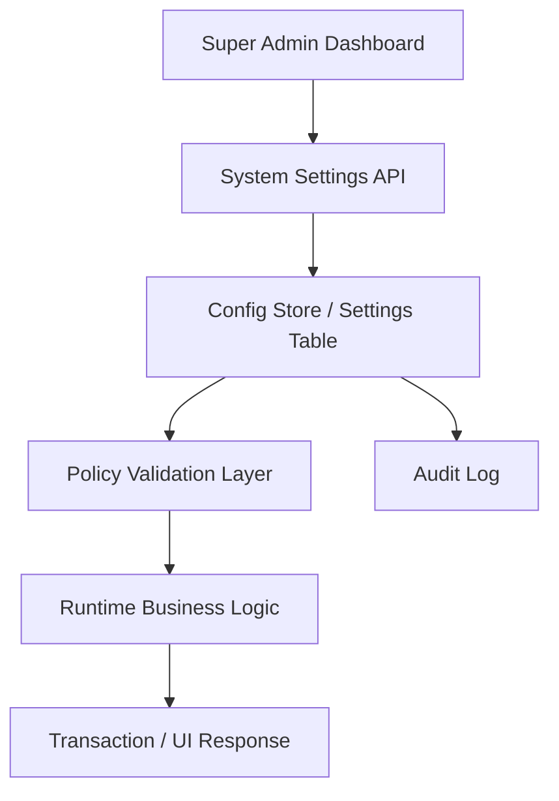

# Architecture Overview

Ikhtisar arsitektur menyoroti pendekatan modular, boundary, dan dependency. Ini adalah rancangan baseline Draft; ADR yang terkait masih memerlukan review/approval dan belum membuktikan implementasi.

## Layered Model

1. **Presentation**: staff dashboard and customer portal; renders permission-aware UI and submits commands, but is not an authorization boundary.
2. **Application/API**: validates request schema, authenticated actor, organization/branch context, workflow state, idempotency, and orchestration.
3. **Domain modules**: own business rules and write models for sales, inventory, service, clinical, finance, workforce, and other domains.
4. **Persistence**: PostgreSQL is the transactional source of truth; RLS protects exposed tables and migrations define schema changes.
5. **External adapters**: payment, messaging, delivery, and other providers are isolated behind server-side adapters, secret management, timeout/retry, and reconciliation.
6. **Operations**: monitoring, audit, backup/restore, release, and incident response support the runtime.

## Module Boundaries

Domain ownership and candidate table boundaries are listed in [feature-to-module mapping](../13-traceability/feature-to-module-mapping.md). Each module owns its invariants and write operations. Shared code is limited to stable primitives (identity context, money/date types, error envelope, audit interface); it must not become a dumping ground for domain rules.

## Integration Pattern

Cross-module communication occurs through service layer / DB transactions and not by direct data mutation without a validated API contract.

## Transaction and Event Boundaries

- Keep one PostgreSQL transaction around related writes that must commit together inside the system (for example a confirmed sale and its stock/loyalty/journal effects when policy requires).
- Do not describe a third-party payment or messaging call as part of a PostgreSQL atomic transaction. Use persisted attempts, idempotency, verified callbacks/polling, transactional outbox where applicable, and reconciliation/compensation.
- The domain owning the write is responsible for validation and state transition; consumers request an operation through its service/API or a documented event.
- Cross-domain read models may aggregate data but do not grant the reporting module ownership of source data.
- Finalized medical and financial records are corrected through revision/reversal flows, not cross-module updates.

## Tenant and Security Boundary

Organization membership and active branch are established from server-verified identity/assignment. Frontend-selected scope is only a request. API/Edge Function authorization and RLS enforce the same tenant boundary; service-role access remains server-side and narrowly audited.

## Dynamic Configuration Layer

PETORA harus menyediakan layer konfigurasi dinamis agar kebijakan yang belum final dapat diatur oleh Super Admin melalui dashboard frontend tanpa harus memodifikasi source code atau deployment baru.

### Scope of Dynamic Policy

- operational settings
- branch-specific business rules
- approval matrix
- promotion and loyalty settings
- cancellation and refund thresholds
- stock policy tolerances
- notification template and delivery policy
- tax and document formatting configuration

### Design Pattern

### Implementation Principles

- Source of truth untuk policy business adalah tabel konfigurasi, bukan hardcoded constant di frontend.
- Frontend hanya menampilkan konfigurasi yang relevan dan sesuai role.
- Server-side harus memvalidasi request perubahan setting, termasuk scope organisasi dan cabang.
- Setting kritis harus berasal dari allowlisted key/schema catalog dan server menentukan lock, approval, dan risk classification; client tidak menentukan flag enforcement.
- Active setting terpisah dari change proposal. Pending/rejected proposals tidak memengaruhi runtime; activation menulis nilai aktif, version, dan audit secara transaksional.
- Pengambilan setting dilakukan melalui server-side policy service. Cache invalidation atau version refresh harus memastikan request baru tidak membaca policy stale setelah aktivasi.
- Scope baseline adalah organization atau branch; global lintas tenant menunggu keputusan tenancy.

### Note

This design is a proposal and must be reconciled with approved ADRs, executable schema, security tests, and operational objectives when implementation begins.

## Related Documents

- [System Context](system-context.md)
- [Module Architecture](module-architecture.md)
- [Architecture Decisions](architecture-decisions.md)
- [Database Design](../04-database/database-design.md)
- [Authentication and Authorization](../05-backend/authentication-authorization.md)
- [Documentation Completeness Report](../13-traceability/documentation-completeness-report.md)

