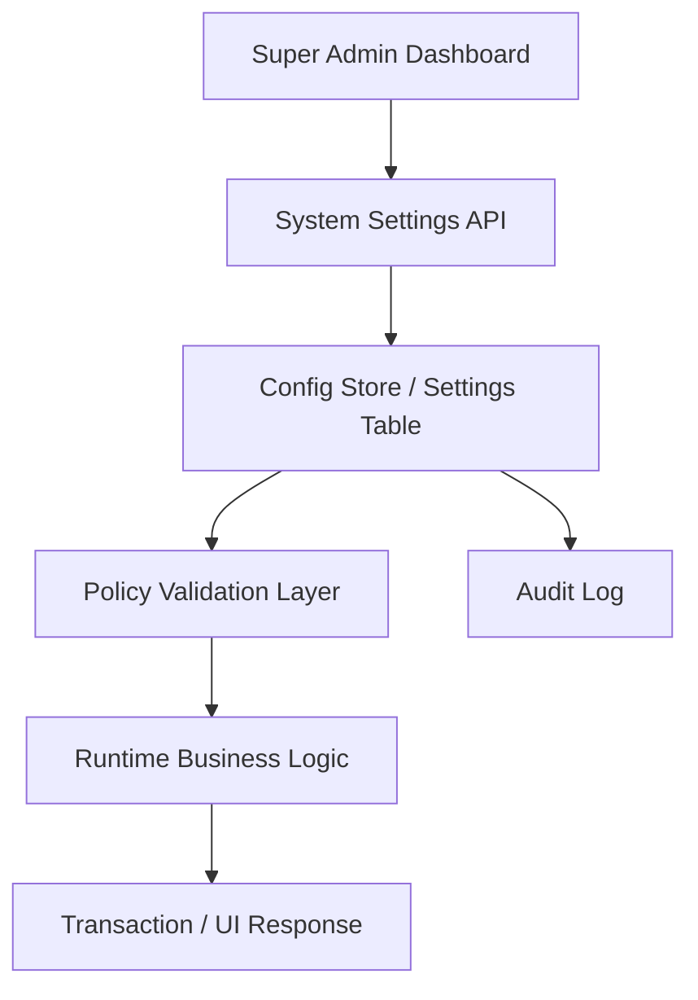

# Architecture Overview

Ikhtisar arsitektur menyoroti pendekatan modular, boundary, dan dependency.

## Layered Model

Presentation Layer, Application Layer, Domain Services, Data Access Layer, Infra/Platform Layer.

## Module Boundaries

Sales, Inventory, Customer, Service, Veterinary, Finance, HR, Reporting, Security, and Portal are domain modules. Shared module contains common types and utilities.

## Integration Pattern

Cross-module communication occurs through service layer / DB transactions and not by direct data mutation without a validated API contract.

## Dynamic Configuration Layer

PETORA harus menyediakan layer konfigurasi dinamis agar kebijakan yang belum final dapat diatur oleh Super Admin melalui dashboard frontend tanpa harus memodifikasi source code atau deployment baru.

### Scope of Dynamic Policy

- operational settings
- branch-specific business rules
- approval matrix
- promotion and loyalty settings
- cancellation and refund thresholds
- stock policy tolerances
- notification template and delivery policy
- tax and document formatting configuration

### Design Pattern

### Implementation Principles

- Source of truth untuk policy business adalah tabel konfigurasi, bukan hardcoded constant di frontend.
- Frontend hanya menampilkan konfigurasi yang relevan dan sesuai role.
- Server-side harus memvalidasi request perubahan setting, termasuk scope organisasi dan cabang.
- Setting kritis harus diberi flag `is_system_locked`, `requires_approval`, atau `affects_finance`.
- Perubahan yang memengaruhi transaksi harus di-record dalam audit log dan memicu invalidation cache.

### Note

This design is baseline and shall be adjusted when actual implementation exists.

