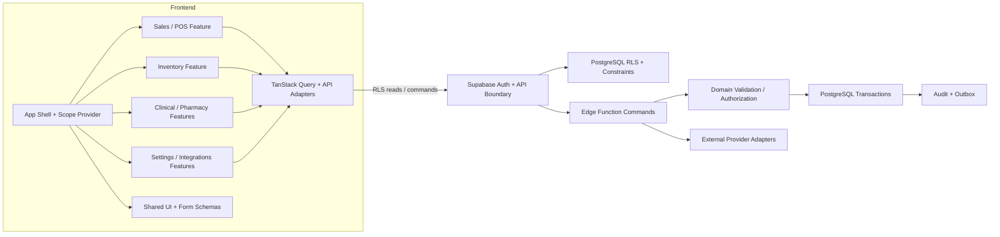

# Component Diagram

Component view menunjukkan pembagian antara UI feature modules, API adapters, authorization boundary, dan domain services.

## Main Components

App shell/session/scope provider; feature modules for organization/customer/pet/catalog/sales/inventory/procurement/booking/services/clinical/pharmacy/workforce/finance/reporting/settings/portal; shared design primitives; feature API adapters and TanStack Query client.

## Cross-cutting Components

Supabase Auth identity, DB-backed authorization/RLS, Edge Function command handlers, domain validators, PostgreSQL transaction/ledger constraints, audit/outbox, Storage authorization, provider adapters, and monitoring. Frontend permission helpers only control presentation.

## Mermaid

## Boundary Rules

Feature UI does not directly write cross-domain transaction state. Shared UI contains no business permission. RLS protects direct reads; command handler rechecks actor/scope/action. Audit/outbox is committed with relevant state. See [module architecture](module-architecture.md) for ownership and dependency rules.

