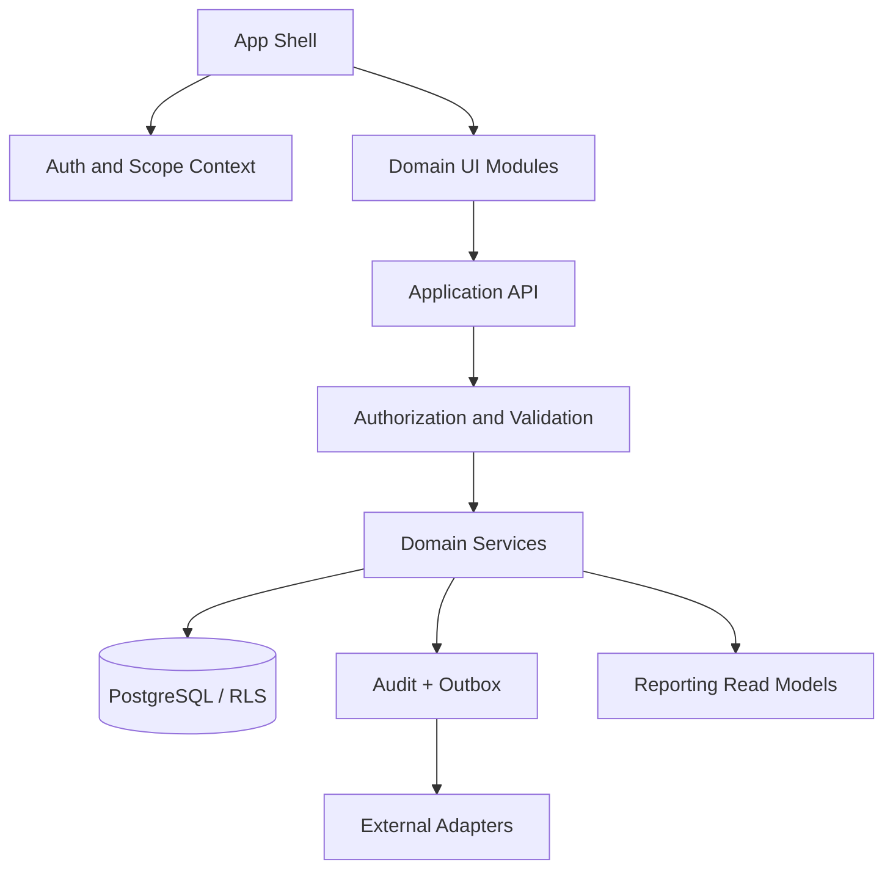

# Component Diagram

Diagram komponen menunjukkan pembagian fitur agar domain tetap terisolasi.

## Main Components

| Component | Owns | Does not own |
| --- | --- | --- |
| App Shell / Route Guard | Navigation, session loading, permission-aware route entry | Final authorization decision |
| Identity Context | Verified subject, organization and branch selection state | User-selected IDs as grants |
| Domain Application Services | Command validation and orchestration for each domain | Direct writes into another domain's private tables |
| Sales/POS | Cart, sale state, payment attempt references | Stock ledger or accounting source of truth |
| Inventory | Stock ledger, batches/location balance, reservations | Sale pricing or payment completion |
| Clinical / Pharmacy | Visit, record, prescription and dispense workflow | Payroll and generic customer-service access |
| Finance / Accounting | Cash reconciliation and journal lifecycle | Provider's settlement truth before verification |
| Reporting | Scoped read model, report jobs and exports | Source-domain mutations |
| Settings Service | Allowlisted config, proposal, approval, active version | Secret storage or client authorization |
| Audit / Outbox | Durable audit references and retryable integration events | Sensitive payload logging |

## Cross-cutting Components

Request schema validation, authorization policy evaluator, tenant context resolver, idempotency service, audit writer, transactional outbox, error mapper, notification adapter, and cache/version invalidation.

## Mermaid

The diagram is logical, not a component package/file layout. Frontend components may share UI primitives, but domain policy and data access remain in owning services. Authorization is checked on every server command even when a route guard already ran.

## Related Documents

- [Module Architecture](module-architecture.md)
- [Backend Architecture](../05-backend/backend-architecture.md)
- [Frontend Component Architecture](../06-frontend/component-architecture.md)

