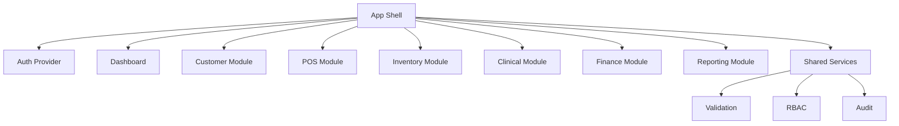

# Component Diagram

Diagram komponen menunjukkan pembagian fitur agar domain tetap terisolasi.

## Main Components

App shell, auth gateway, dashboard, customer module, sales pos, inventory, clinical, finance, payroll, reports, and shared services.

## Cross-cutting Components

Validation layer, RBAC service, audit logger, notifications, cache layer, and API client helpers.

## Mermaid

