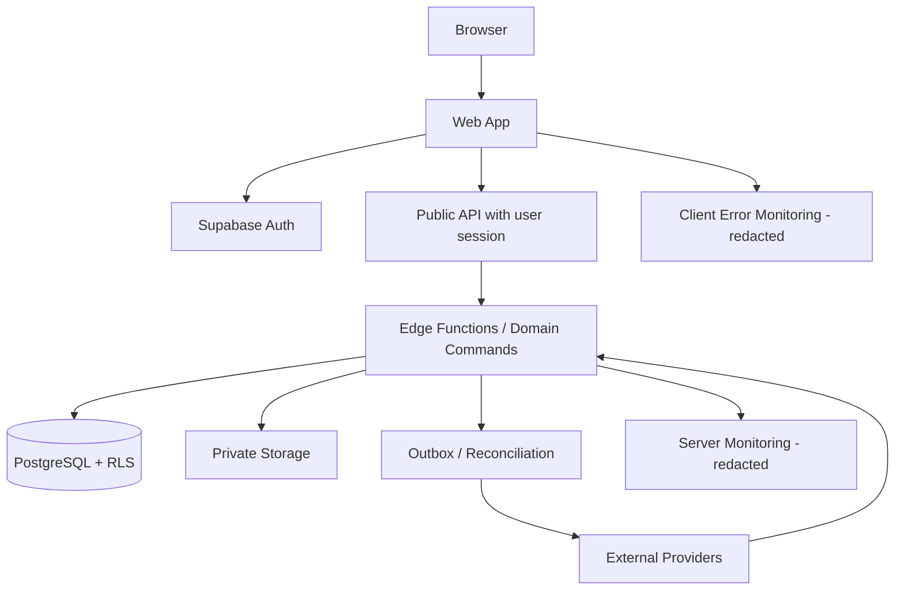

# Container Diagram

Diagram container mengilustrasikan penyebaran platform.

## Containers and Trust Boundaries

| Container | Responsibility | Sensitive boundary |
| --- | --- | --- |
| Browser Web App | React/Vite user interface, form state, accessible workflows | Public code only; no service role/provider secret; never authoritative for price or permission |
| Supabase Auth | Sign-in, session and identity | Claims must be server-managed; MFA/provider choices are open decisions |
| API / Edge Functions | Validate requests, resolve scope, orchestrate domain commands and provider calls | Server-side credentials, stable errors, rate limits and authorization |
| PostgreSQL | Source of truth, transaction constraints and RLS | Tenant isolation, transaction boundary and migration control |
| Private Storage | Customer, clinical and transaction documents | Per-object authorization, short-lived access, retention and audit |
| Realtime | Updates for authorized client subscriptions | Same tenant/scope checks; not the source of truth for critical state |
| Monitoring | Logs, metrics, traces and alerts | Redaction; no credentials or unnecessary clinical payload |
| External Providers | Payment, email/SMS/WhatsApp, shipping if selected | Signed callbacks, idempotency, timeout and reconciliation |

## Deployment Base

Vercel/Cloudflare Pages, Supabase, and Sentry/equivalent are candidate providers, not final deployment decisions. Environment ownership, region, data residency, secret injection, support coverage, backup responsibility, and cost need approval before production.

## Mermaid

Direct user-scoped reads may use the Data API only for tables with reviewed RLS policies. All privileged writes and external side effects pass through server-side handlers. A deployment diagram is not a substitute for the approved provider/deployment ADR.

## Related Documents

- [System Context](system-context.md)
- [Environment Configuration](../10-devops/environment-configuration.md)
- [Secrets Management](../08-security/secrets-management.md)

