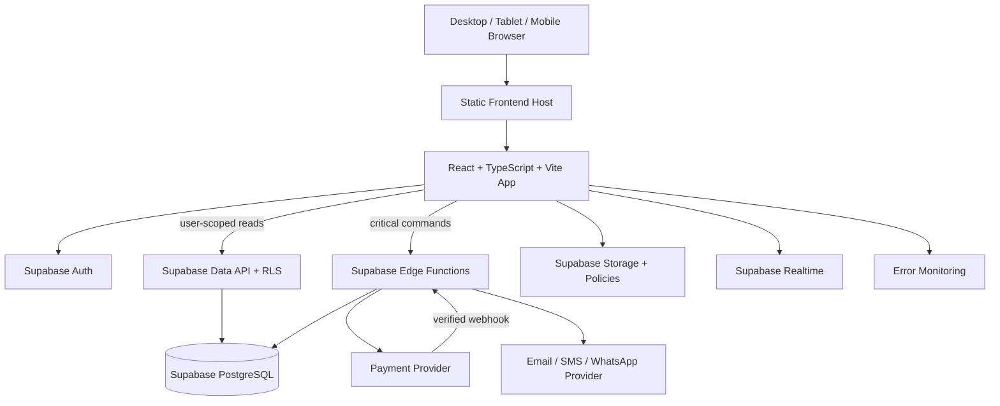

# Container Diagram

Container view menggambarkan runtime target berdasarkan technology baseline, bukan inventory deployment yang telah diverifikasi.

## Containers

React + TypeScript + Vite web app; Supabase Auth; Supabase Data API/PostgREST with RLS; Supabase Edge Functions; PostgreSQL; Supabase Storage; Supabase Realtime; external payment/notification providers; frontend hosting (Vercel or Cloudflare Pages); Sentry/equivalent monitoring. GraphQL, queue provider, and separate backend services are not baseline requirements unless an ADR approves them.

## Deployment Base

Frontend may deploy to Vercel or Cloudflare Pages; database/Auth/Storage/Edge Functions/Realtime use Supabase. Environment separation and provider/region/backup configuration remain open decisions.

## Mermaid

## Container Responsibilities

- Browser holds no service-role/database credential; it sends user intent and renders authorized data.
- Data API is for RLS-protected access; Edge Functions orchestrate secret-bearing or multi-step commands.
- PostgreSQL enforces constraints, transactions, RLS, and durable audit/outbox.
- Storage/Realtime policies mirror parent record scope; events are hints that trigger refetch.
- Provider calls have idempotency/reconciliation; monitoring scrubs PII/medical values.

Note: no separate queue technology is selected; an outbox/async mechanism is a logical requirement where needed, while implementation choice remains an ADR/open decision.

