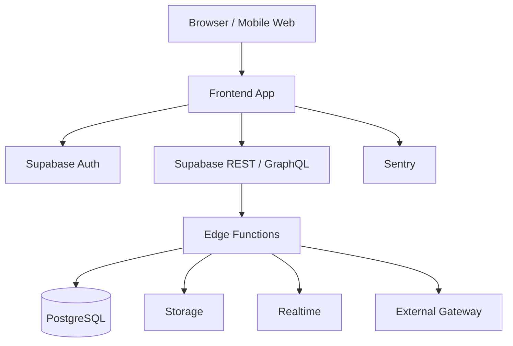

# Container Diagram

Diagram container mengilustrasikan penyebaran platform.

## Containers

Web app (React/Vite), API layer (Supabase PostgREST + Edge Functions), Database (PostgreSQL), Storage, Realtime, Auth, Monitoring, and External services.

## Deployment Base

Frontend can run on Vercel or Cloudflare Pages; backend and database on Supabase; monitoring via Sentry or equivalent.

## Mermaid

