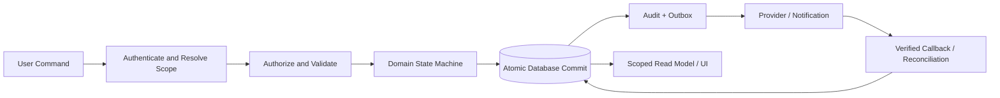

# Data Flow Diagram

Diagram aliran data menggambarkan bagaimana transaksi dan event dialirkan melalui aplikasi dan database.

## Key Flows

### Checkout with External Payment

1. Client submits cart and idempotency key; server recalculates price and validates customer, branch, promo and stock.
2. Server creates a durable payment attempt/reservation under a documented state machine.
3. Provider outcome is verified via signed callback or reconciliation query; timeout remains pending.
4. A database transaction commits sale, payment state, stock ledger, loyalty event and journal source according to approved accounting boundary.
5. Receipt/notification is generated from committed state through an outbox; duplicate callbacks return the existing outcome.

### Clinical Visit and Dispense

1. Staff verifies pet/owner and visit assignment; clinician records examination and consent.
2. Doctor finalizes a versioned medical record and authorized prescription.
3. Pharmacy verifies prescription, patient, dose and batch; dispense and stock ledger commit together.
4. Billing references visit and dispensed items; owner visibility follows clinical policy.

### Settings Change

Proposer submits key, proposed value, reason and expected version. Server validates key/schema/scope/role. Pending proposal remains separate from active value. Approver decision, active update, version snapshot and audit are committed atomically. Runtime policy reads only active version.

## Mermaid

## Data Flow Controls

- Use correlation/request IDs across client, function, database event, and provider reference.
- Do not log full clinical/payment payloads; store minimal references and redacted summaries.
- Every asynchronous flow exposes a durable status and reconciliation path.
- Only committed authoritative records feed final reports; pending attempts are shown separately.

## Related Documents

- [Business Processes](../02-business-analysis/business-processes.md)
- [Transaction Integrity](../04-database/transaction-integrity.md)
- [Integration Architecture](integration-architecture.md)

