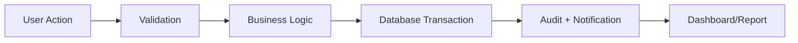

# Data Flow Diagram

Diagram aliran data menggambarkan bagaimana transaksi dan event dialirkan melalui aplikasi dan database.

## Key Flows

Customer registration, product sale, stock receipt, appointment booking, and financial posting.

## Mermaid

