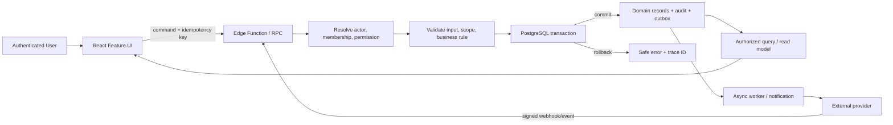

# Data Flow Diagram

Diagram aliran data menggambarkan bagaimana transaksi dan event dialirkan melalui aplikasi dan database.

## Core Flows

Diagram menunjukkan batas browser/server/database dan event eksternal; implementasi spesifik dapat memakai PostgREST/RPC/Edge Function sesuai contract. Semua payload dari browser dianggap tidak tepercaya.

## Mermaid

## Consistency Rules

- Harga, discount, tax, scope, and permission dihitung/diperiksa server-side.
- Database writes untuk satu local invariant commit/rollback bersama; external provider side effects menggunakan state machine dan reconciliation, bukan distributed ACID claim.
- Audit/outbox ditulis bersama perubahan saat diperlukan; consumer dedupe berdasarkan event ID.
- Dashboard/report mengonsumsi data yang sudah diotorisasi dan mencantumkan freshness/scope.

## Failure Paths

Invalid auth/scope ditolak sebelum write; validation/conflict tidak membuat partial state; external timeout menandai unknown/pending untuk reconciliation; callback duplikat tidak mem-post event dua kali. Trace ID menghubungkan UI/API/DB/provider tanpa membawa secret/medical payload.

## Related Documents

- [Transaction integrity](../04-database/transaction-integrity.md)
- [Backend architecture](../05-backend/backend-architecture.md)
- [Integration architecture](integration-architecture.md)

