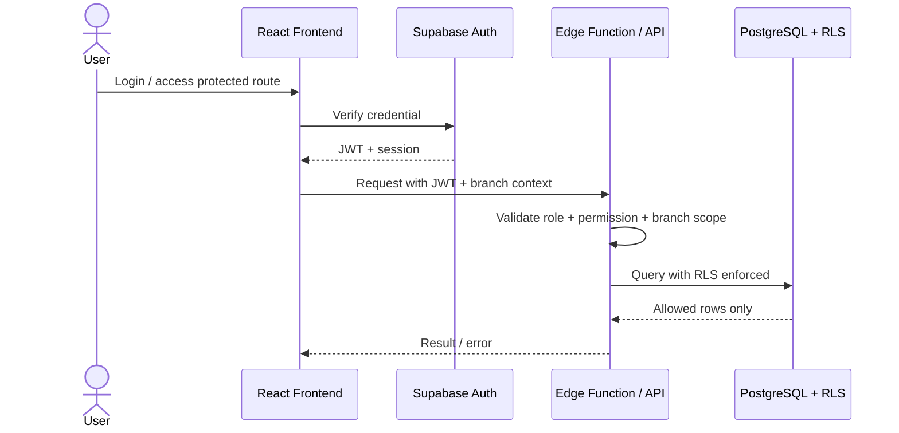
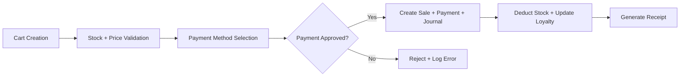

# Software Architecture Document

Dokumen arsitektur menjelaskan bagaimana PETORA dirancang sebagai aplikasi modular berbasis React dan Supabase, dengan fokus pada integrasi data multi-cabang, keamanan, dan transaksi bisnis kritis.

## 1. Architecture Overview

PETORA menggunakan arsitektur modular monolith pada level aplikasi. Secara logis, aplikasi dibagi menjadi domain utama seperti customer, inventory, sales, veterinary, finance, HR, reporting, dan portal. Pada level deployment, seluruh domain tetap dipasang dalam satu frontend application dan satu Supabase backend, namun dibatasi oleh boundary modul dan policy database yang jelas.

## 2. Architectural Principles

- Multi-tenant by organization: data organisasi selalu disaring berdasarkan tenant_id / organization_id.
- Branch-aware access control: data cabang hanya dapat diakses sesuai assignment dan policy.
- Server-side enforcement: semua validasi otorisasi dan rule bisnis kritis diproses pada server atau database, bukan di browser.
- Atomic transaction: stock, payment, refund, journal, and medical prescription flows harus commit secara utuh.
- Auditability: setiap perubahan penting dicatat dengan actor, timestamp, reason, and affected record.
- Maintainability: modul dibuka untuk evolusi tanpa membahayakan integritas data.

## 3. Responsibility Split

### Frontend
- Menyediakan UI dashboard, POS, service management, module settings, customer portal, dan operational tools.
- Menangani validasi form, status loading/error, role-based rendering, branch context, dan notifikasi user.
- Berkomunikasi dengan Supabase melalui API/Edge Function.

### Backend
- Menyediakan auth, authorization, business workflow, API orchestration, integrations, and storage access.
- Melakukan validasi request, branch scope, price rules, payment status, and stock availability.
- Menyelenggarakan edge functions untuk operasi kritis seperti checkout, refund, reconciliation, and prescription validation.

### Database
- Menyimpan relasional data master dan transaksi.
- Menjalankan RLS, constraints, foreign keys, check constraints, dan transactional logic.
- Menyediakan audit log dan stock ledger untuk traceability.

## 4. Module Boundaries

| Domain | Responsible modules | Key dependencies |
| --- | --- | --- |
| Shared / security | auth, role, audit, tenant, branch context | organization config, user profile |
| Customer & pet | customer management, pet profile, membership | branch, notification |
| Sales & inventory | POS, stock, purchasing, supplier, consignment | product, payment, finance |
| Service operations | grooming, booking, hotel, transport, home grooming | customer, pet, branch |
| Clinical & pharmacy | vet, medical record, pharmacy | pet, inventory, billing |
| HR & payroll | staff, attendance, commission, payroll | branch, finance |
| Finance & accounting | finance, accounting, AP/AR, reports | sales, purchase, payroll |
| Portal & channels | notifications, portal, integrations | customer, booking, reporting |

## 5. Authentication and Authorization Flow

## 6. Checkout and Payment Flow

## 7. Data Flow Pattern

Semua operasi utama mengikuti pola berikut:
1. User input validasi di frontend.
2. API memvalidasi otorisasi, scope, dan business rules.
3. Database transaction memproses mutasi pada tabel utama.
4. Audit log dan event notifikasi dibuat.
5. UI diberi refresh data via query invalidation atau realtime.

## 8. Quality Attributes

### Scalability
- Domain dapat dikembangkan menjadi feature modules tanpa mengubah seluruh aplikasi.
- Query besar harus via server-side aggregation dan indeks yang tepat.

### Reliability
- Fitur kritis memerlukan retry-safe and idempotent processing untuk payment, refund, and stock mutation.
- Gunakan transaction-block dan server-side orchestration untuk event multi-table.

### Maintainability
- Domain model dipisahkan di layer modul.
- Shared components, hooks, and service clients digunakan untuk reuse.

### Observability
- Semua endpoint dan edge function harus menyediakan trace_id dan error code.
- Laporan error melalui Sentry atau monitoring yang setara.

## 9. Security Architecture Alignment

The system uses auth, RLS, edge-function enforcement, admin-only secret handling, and audit logs to protect:
- organization separation,
- branch isolation,
- customer and pet data,
- financial and inventory integrity,
- clinical and prescription rules.

## 10. Open Architectural Decisions

- Modul yang levelnya terlalu kompleks dapat dipisahkan lebih lanjut saat beban operasional meningkat.
- Integrasi ke gateway pembayaran dan notifikasi external akan mengikuti contract tetap dan server-side secret management.

## Related Documents

- [architecture-overview.md](architecture-overview.md)
- [system-context.md](system-context.md)
- [container-diagram.md](container-diagram.md)
- [component-diagram.md](component-diagram.md)

