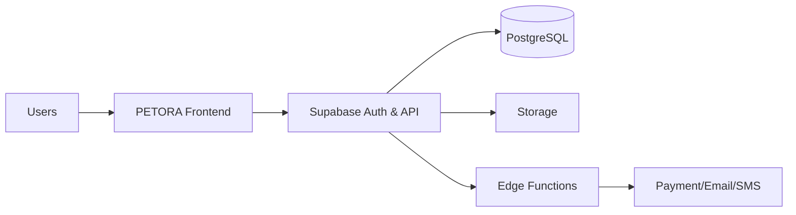

# System Context

Konteks sistem menggambarkan PETORA sebagai solusi bagi organisasi, cabang, pegawai, pelanggan, supplier, dan layanan eksternal.

## Actors

Owner, Branch Staff, Customer, Supplier, External Payment Gateway, Notification providers, and Admin.

## Context Flow

User interacts with frontend; frontend calls Supabase API; database stores critical data; edge functions mediate high-risk workflows.

## External Systems

Payment gateway, SMS/WhatsApp/email platform, file storage, and monitoring such as Sentry.

## Mermaid

