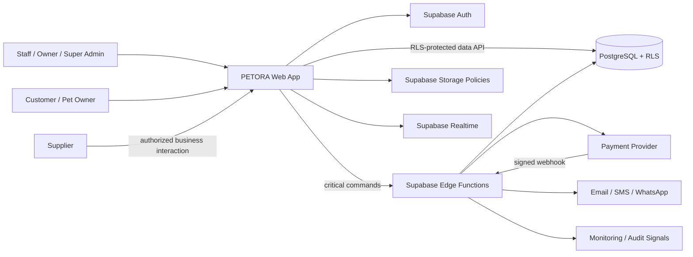

# System Context

System context menunjukkan boundary PETORA dan aktor eksternal. Organisasi/branch data berada dalam tenant scope; provider eksternal tidak dipercaya sebagai source of truth tanpa verifikasi.

## Actors

Owner/business decision maker, Super Admin, branch staff (cashier, inventory, service, clinical, HR, finance), customer/pet owner, supplier, payment provider, email/SMS/WhatsApp provider, and optional shipping provider (recommended extension). Supplier/provider access is limited to explicit integration contracts; they are not internal PETORA users by default.

## Context Flow

Staff/customer access React web experience using Supabase Auth identity. Frontend reads through RLS-protected Data API and issues critical commands to Edge Functions/database functions. PostgreSQL persists tenant-scoped business records, audit, and transaction state. Storage stores private files under parent-record policy. Realtime signals authorized changes but is not authoritative. Edge Functions call external providers and process verified callbacks.

## External Systems

Payment, notification, and monitoring providers are examples from the README/baseline. Exact vendor, data residency, contract, availability, and support model are open decisions. Frontend hosting target is Vercel or Cloudflare Pages per baseline, not yet selected.

## Mermaid

## Trust Boundaries

Browser input, uploaded files, provider response, and webhook payload are untrusted. Auth identity comes from verified session; tenant/branch authorization comes from trusted membership and RLS. Service-role code path bypasses RLS and requires explicit review/tests. The diagram is target architecture, not evidence that components are deployed.

