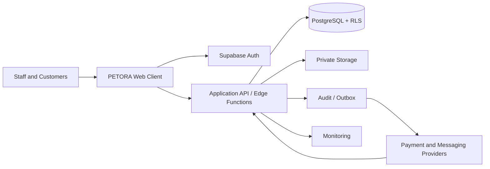

# System Context

Konteks sistem menggambarkan PETORA sebagai solusi bagi organisasi, cabang, pegawai, pelanggan, supplier, dan layanan eksternal.

## Actors and Responsibilities

| Actor/system | PETORA interaction | Trust boundary |
| --- | --- | --- |
| Owner / Branch Manager | Scoped dashboard, approvals, oversight | Authenticated role and organization/branch assignment |
| Branch Staff | POS, stock, service, clinical, workforce workflows | Least-privilege module actions and assigned records |
| Customer | Portal profile, pet, booking, permitted history | Own customer/pet relationship and consent policy |
| Supplier | Supplies, PO/receipt/invoice communication | No direct database access; verified documents/integration only |
| Payment provider | Payment/refund event and settlement data | Untrusted callback until signature and reference verification |
| Notification provider | Message delivery status | Receives only minimized payload; no secret/client authority |
| Hosting/monitoring | Runs frontend/server and observes health | Environment isolation, secret management, access audit |

## Context Flow

1. User authenticates; server validates account state and resolves organization membership/branch assignment.
2. Frontend requests data with session context; UI scope selection is not itself a grant.
3. API/RLS authorizes reads; critical commands go through a server-side domain workflow.
4. PostgreSQL commits authoritative state and audit/outbox records.
5. Server-side adapters call providers asynchronously or through persisted attempts and reconcile callbacks.
6. Reporting reads permission-scoped committed data; portal access additionally checks customer/pet ownership.

## External Systems

Payment gateway, SMS/WhatsApp/email platform, file storage, and monitoring such as Sentry.

## System Responsibilities and Exclusions

PETORA owns business records, authorization decisions, workflow state, idempotency, and reconciliation references. External providers own their delivery/payment processing outcomes; PETORA must verify and record those outcomes but cannot guarantee provider availability. No external party receives database credentials or unrestricted exports.

## Mermaid

## Related Documents

- [Container Diagram](container-diagram.md)
- [Integration Architecture](integration-architecture.md)
- [Security Architecture](../08-security/security-architecture.md)

