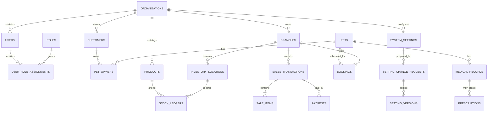

# Entity Relationship Diagram

ERD menjabarkan hubungan antar tabel utama dalam sistem.

## Entity Map and Cardinality Notes

Organization owns branches and tenant-wide configuration. User identity may be a platform identity linked to one or more organization assignments; role assignment is scoped and should not be modeled as a single role column on user. Customers may own multiple pets; multi-owner history requires a dedicated relationship entity if approved. Branch-scoped sales, stock, bookings, visits, payroll and journal source records retain organization and relevant branch references. Product catalog may be organization-wide with branch price/availability overrides.

The diagram is conceptual. Tables marked TBD in [module-to-database mapping](../13-traceability/module-to-database-mapping.md) require approved attributes, keys, constraints, and deletion rules before migration.

## Design Note

Diagram ini bersifat konseptual dan harus diperbarui saat skema final dibuat.

## Mermaid ER

`PET_OWNERS`, branch-level product price, payment attempts, refund requests, inventory batches, and several service/finance entities are logical candidates, not approved physical tables. Validate ER cardinalities and composite tenant foreign keys during schema design.

## Related Documents

- [Database Design](database-design.md)
- [Data Dictionary](data-dictionary.md)
- [Module to Database Mapping](../13-traceability/module-to-database-mapping.md)

