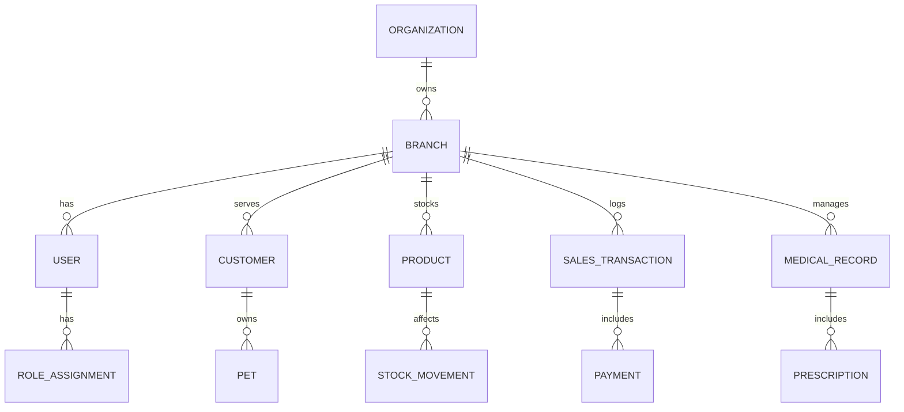

# Entity Relationship Diagram

ERD menjabarkan hubungan antar tabel utama dalam sistem.

## Entity Map

Organizations -> Branches -> Users -> Roles -> Permissions; Branches -> Customers -> Pets -> Bookings; Branches -> Products -> Inventory; Product -> Purchase Orders -> Receipts -> Stock Ledger; Branch -> Sales -> Sales Items -> Payments; Branch -> Medical Records -> Prescriptions -> Pharmacy Usage; Branch -> Payroll and Finance journals.

## Design Note

Diagram ini bersifat konseptual dan harus diperbarui saat skema final dibuat.

## Mermaid ER

