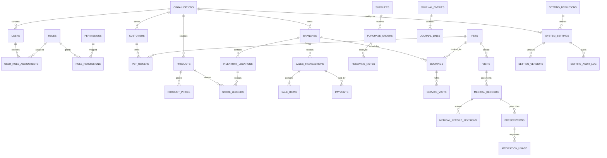

# Entity Relationship Diagram

ERD ini adalah model logical konseptual untuk domain core PETORA. Nama tabel/relasi masih rancangan dan harus disinkronkan dengan database design serta data dictionary sebelum migration; diagram tidak mengklaim schema telah diimplementasikan.

## Relationship Summary

Organization memiliki branches dan user profiles; user memperoleh role melalui assignment dengan scope branch. Customer dapat memiliki banyak pets melalui ownership relation dengan satu current primary owner. Product/service catalog digunakan inventory, sales, purchasing, booking, pharmacy, dan reporting. Stock ledger mencatat seluruh penerimaan, pengeluaran, transfer, reservation, adjustment, dan dispensing. Booking menghubungkan customer/pet, branch, service, resource, dan service visit. Clinical visit memiliki medical record final/revisions, consent, prescription, dan medication usage. Sales/payment dan purchasing/receiving menghasilkan posting finance/accounting yang dapat direkonsiliasi. Settings menggunakan registry, scoped settings, version, dan append-only audit log.

## Mermaid ERD

## Integrity and Scope Notes

- Child transaction boleh menyimpan tenant scope untuk RLS/query, tetapi konsistensi harus dijaga dengan composite FK atau validasi server-side.
- `branch_id` bukan relasi universal; master tingkat organisasi tidak dipaksakan ke satu branch.
- Audit/history bersifat append-only dan tidak menghapus source record.
- Extension README bagian 5 belum ditampilkan; ERD-nya dibuat saat extension disetujui.

## Related Documents

- [Database design](database-design.md)
- [Data dictionary](data-dictionary.md)
- [Module-to-database mapping](../13-traceability/module-to-database-mapping.md)

