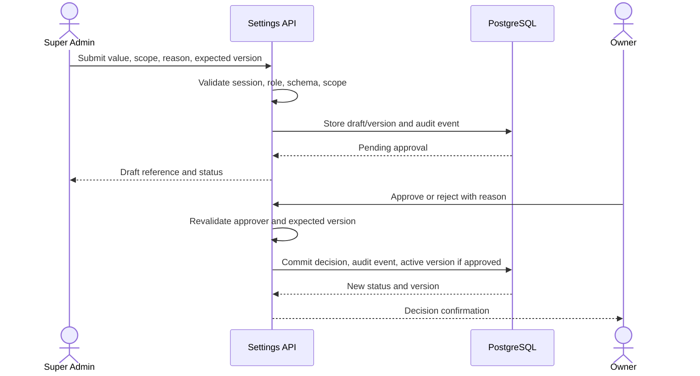

# Audit Logging

Audit log mendokumentasikan aktivitas penting.

## Log Events

Login/logout, role changes, stock adjustments, payment, refund, user profile changes, medical record revision, journal posting, approval events, and delete/archive actions.

Untuk dynamic settings, log minimum meliputi create draft, update draft, validation failure, submit for approval, approve, reject, activate, rollback, perubahan scope, serta percobaan akses yang ditolak. Log harus menghubungkan event dengan setting key, organization/branch scope, version ID, actor, dan correlation/trace ID.

## Metadata

Include actor_id, timestamp, action, data_class, affected_entity, before/after summary, ip/agent if available, and trace_id. Untuk perubahan setting, metadata tambahan yang diperlukan:

| Field | Keterangan |
| --- | --- |
| setting_id / setting_key | Identitas configuration yang berubah |
| organization_id / branch_id | Scope yang telah divalidasi server |
| old_version_id / new_version_id | Relasi ke versi sebelum dan sesudah |
| approval_status | Draft, pending, approved, rejected, activated, atau rolled back |
| reason | Alasan dari pemohon atau approver |
| request_id | Korelasi event API dan audit |

Simpan ringkasan nilai sebelum/sesudah hanya jika aman. Token, password, credential, dan data sensitif tidak boleh dicatat plaintext; redaksi harus diterapkan sebelum log ditulis.

## Integrity and Access

- Audit event harus ditulis dalam transaksi yang sama dengan perubahan setting yang berhasil, atau melalui transactional outbox yang menjamin event tidak hilang.
- Aplikasi normal tidak boleh mengubah atau menghapus audit record yang sudah committed.
- Baca audit dibatasi pada role compliance/Owner/Super Admin yang berwenang dan tetap mengikuti tenant scope.
- Penolakan akses sensitif juga dicatat, tetapi log tidak boleh menyimpan payload rahasia atau seluruh request body.
- Audit export harus dibatasi, dicatat sebagai event baru, dan mengikuti data minimization.

## Dynamic Settings Audit Lifecycle

## Retention

Retain as per policy and restrict access to compliance or admin roles only. Masa retensi final, legal hold, serta proses penghapusan setelah masa retensi belum ditetapkan dan menjadi open decision; jangan menghapus audit untuk mengatasi kapasitas tanpa prosedur yang disetujui.

## Related Documents

- [Security architecture](security-architecture.md)
- [Database design](../04-database/database-design.md)
- [Administrator manual](../11-operations/administrator-manual.md)

