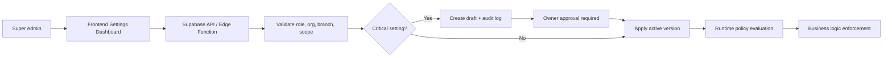

# Security Architecture

Arsitektur keamanan PETORA berfokus pada isolasi organisasi, branch, role, dan data sensitif.

## Purpose

Dokumen ini menjelaskan bagaimana PETORA melindungi akses data multi-tenant, multi-branch, serta konfigurasi dinamis yang dapat diubah oleh Super Admin. Fokus utamanya adalah meminimalkan risiko kebocoran data, manipulasi parameter bisnis, dan pelanggaran otorisasi selama operasi checkout, clinical, keuangan, stok, dan pengaturan sistem.

## Scope

Lingkup dokumen mencakup autentikasi, otorisasi, keamanan antara frontend dan Supabase, RLS, storage, edge function, logging audit, pengelolaan konfigurasi dinamis, serta proteksi data sensitif seperti token integrasi, medical record, dan jurnal keuangan.

## Security Principles

- Least privilege: hak akses diberikan sesuai kebutuhan tugas tertentu.
- Tenant isolation: user hanya dapat melihat data organisasi miliknya.
- Branch isolation: akses cabang mengikuti scope branch dan role.
- Validation on server: setiap operasi kritis diverifikasi di server atau database, bukan pada browser.
- Immutable audit: perubahan konfigurasi, akses sensitif, dan transaksi kritis dicatat secara permanen.
- No secret in frontend: secret API dan service role tidak pernah dipasang di client.

## Trust Boundary

PETORA membagi boundary keamanan sebagai berikut:

1. Browser / frontend: hanya menerima data yang sudah diotorisasi; tidak memiliki secret atau permission yang dapat digunakan untuk bypass.
2. Supabase API: menangani autentikasi, session, RLS, dan validasi data struktur.
3. Edge Functions: menjalankan bisnis logic sensitif seperti approval, stock deduction, payment reconciliation, dan system settings validation.
4. PostgreSQL: sumber kebenaran transaksi, jurnal, dan policy enforcement.

## Dynamic Settings Governance

PETORA memperlakukan beberapa kebijakan sebagai konfigurasi runtime yang dapat diubah dari dashboard Super Admin. Konfigurasi ini mencakup:

- refund_policy
- loyalty_policy
- stock_policy
- service_policy
- pricing_policy
- notification_policy

### Security Rule for Dynamic Settings

- Semua perubahan harus diautentikasi dengan session yang valid.
- Hanya Super Admin atau Owner dengan hak approval yang dapat mengubah config khusus.
- Scope baseline dibatasi ke organization atau branch; global lintas tenant belum didukung sampai keputusan tenancy disetujui.
- `value_type` harus cocok dengan schema valid sebelum disimpan.
- `requires_approval=true` mengharuskan status draft dan persetujuan sebelum config aktif.
- Sistem menolak perubahan jika `is_system_locked=true` dan tidak disetujui oleh owner/super admin.
- Perubahan harus menghasilkan `setting_audit_log` dan `setting_versions`.

### Example Security Flow



## Role and Permission Model

| Role | Access to settings | Approval power | Restriction |
| --- | --- | --- | --- |
| Super Admin | Full settings management | Full approval | Cannot bypass RLS or lock policy |
| Owner | Review and approve critical settings | Yes | Cannot edit without approved path |
| Branch Manager | Read branch-scoped settings | No | Only relevant branch scope |
| Finance / Inventory / Clinical | Read-only on specific runtime config | No | No direct mutation |

## RLS and Policy Enforcement

RLS harus aktif untuk seluruh tabel yang mungkin diakses dari API. Data organisasi dan cabang tidak boleh dipetakan hanya dari payload frontend.

### Design Example

```sql
-- Rancangan awal: settings tidak diekspos melalui Supabase Data API.
ALTER TABLE public.system_settings ENABLE ROW LEVEL SECURITY;
ALTER TABLE public.setting_change_requests ENABLE ROW LEVEL SECURITY;
ALTER TABLE public.setting_versions ENABLE ROW LEVEL SECURITY;
ALTER TABLE public.setting_audit_log ENABLE ROW LEVEL SECURITY;
```

Tanpa policy client, RLS menolak akses Data API secara default. Settings dibaca dan diubah hanya melalui Edge Function/server endpoint yang memverifikasi user, permission, organization, branch assignment, key allowlist, lock state, approval, dan expected version sebelum memakai akses privileged. Service role tidak boleh diteruskan ke frontend. Jika desain kelak mengizinkan pembacaan langsung, tambahkan policy role-aware dan negative tests terlebih dahulu; jangan menyalin policy tenant-only yang memberi semua anggota organisasi akses ke seluruh policy.

## Storage, Secrets, and External Integrations

- Secret token integrasi tidak boleh disimpan di frontend.
- Secret harus disimpan di Supabase secret manager atau environment variable server-side.
- File yang berisi identitas pasien atau bukti pembayaran harus dibatasi dengan storage policy.
- Tabel `external_tokens`, `api_keys`, dan `system_settings` harus dipisahkan dari data operasional umum.

## Audit and Accountability

Setiap operasi berikut harus log ke audit trail:

- perubahan configuration dengan approval
- perubahan harga atau diskon
- refund dan void transaksi
- adjustment stok dan opname
- diagnosis, resep, dan tindakan klinik
- akses file dan data sensitif

## Business Critical Transactions

Transaksi kritis harus diproses dengan mekanisme atomic dan harus tidak dapat berjalan dengan partial state. Penjualan, pembayaran, refund, stock movement, invoicing, dan posting jurnal keuangan harus dipastikan konsisten dengan transaksi DB atau server-side workflow.

## Acceptance Criteria Security

- Semua tabel yang dapat diakses dari API memiliki RLS aktif.
- User non-otoritas tidak dapat mengubah `system_settings` atau `setting_versions`.
- Perubahan konfigurasi kritis wajib melalui approval.
- Cross-organization access denied with audit entry.
- Cross-branch access denied unless explicitly allowed.
- Frontend tidak mengandung credential atau service role key.

## Related Documents

- [security-policies.md](security-policies.md)
- [threat-model.md](threat-model.md)
- [data-protection.md](data-protection.md)


